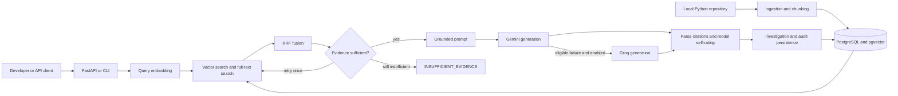

<div align="center">

# IncidentWeave

**As of 2026-11-01.**

### Evidence-first investigation for local Python repositories

[](https://github.com/iamswayam/incidentweave/actions/workflows/ci.yml)


*A backend/AI engineering project that retrieves repository evidence before asking an LLM to explain an incident.*

[Quick start](#quick-start) · [Architecture](#architecture) · [Evaluation](#evaluation) · [Documentation](#documentation)


</div>

## License

MIT. See [LICENSE](LICENSE).

---

## Why IncidentWeave

An investigation answer is only useful when its evidence can be inspected. IncidentWeave indexes a **local Python repository**, retrieves relevant source chunks with vector and full-text search, checks whether the evidence is sufficient, and only then requests a grounded response from Gemini, with an optional default-off Groq generation fallback.

It is deliberately a bounded system rather than an open-ended agent loop:

- Retrieval is repository-scoped and carries file paths, line ranges, scores, and chunk IDs through the workflow.
- The workflow retries retrieval once with a wider limit, then returns `INSUFFICIENT_EVIDENCE` if evidence is still insufficient.
- Investigations persist an `Investigation` plus an `Audit` record; generated answers, model abstentions, guard refusals, and errors have distinct outcomes.
- The project includes a pinned-corpus evaluation harness, PostgreSQL-backed integration tests, Ruff, Docker, and GitHub Actions CI.

> **Current scope:** IncidentWeave is a local, single-service portfolio project. It indexes Python source only; it is not a multi-user or production-hardened incident platform.

## Architecture



The graph executes hybrid retrieval in-process and does not invoke MCP tools. After one unsuccessful widened retrieval it returns `INSUFFICIENT_EVIDENCE`; the model does not choose tools. The MCP server module still exposes `grep_search` and `hybrid_search`, but neither is called by the investigation graph. See [HLD](docs/architecture/02-high-level-design.md) and [LLD](docs/architecture/03-low-level-design.md) for the implementation-level design.

## What’s implemented

| Capability | Implementation |
|---|---|
| **Repository ingestion** | Traverses eligible local `*.py` files, excludes VCS/cache/tool directories, and creates non-redundant 60-line chunks with 10-line overlap. Chunks matching supported secret patterns are skipped. Each run records `chunker_version`; matching path/range/hash identities keep chunk IDs and embeddings, while changed chunks are added. |
| **Embeddings** | Calls Gemini `gemini-embedding-001` through an async HTTP client, requests 768 dimensions, validates vectors, and batches missing repository chunks in groups of 50 with concurrency capped at 4. |
| **Hybrid retrieval** | Combines pgvector cosine-distance results with PostgreSQL full-text results through Reciprocal Rank Fusion (RRF). |
| **Evidence gate** | Requires at least one retrieved chunk with vector distance at or below the provisional 0.5 cutoff; RRF is for ranking and reporting, not a gate. A chunk without vector distance cannot make evidence sufficient. The cutoff will be re-validated on the held-out split in checklist item 3b. |
| **Grounded generation** | Sends retrieved source content, paths, line ranges, and scores inside tagged, explicitly untrusted evidence sections to Gemini `gemini-3.5-flash-lite`. An explicitly configured, default-off Groq fallback is attempted only after eligible Gemini rate-limit, server, or timeout failures; embeddings remain Gemini-only. Both responses use the investigation JSON contract and evidence validation. |
| **Citations & model self-rating** | Requires each claim to cite a retrieved chunk ID and a verbatim quote of at least 10 characters found case-sensitively after whitespace normalization; reports reference validity separately from claim faithfulness. May lower the model's `high` self-rating when retrieval margins are borderline. The rating is not a measured probability of correctness. |
| **Audit trail** | Persists an investigation and audit for answers, guard refusals, model abstentions, and failures; the investigation stores a typed outcome, and refusals retain retrieval evidence and tool attempts. |
| **API & tooling** | Protected HTTP endpoints, local CLI entry points, a stdio MCP server, Docker Compose, Alembic migrations, pytest, Ruff, and CI. |

Ingest runs record the source path and available Git metadata, and each investigation audit links to the latest run. Chunks no longer present in a later ingest are deleted rather than archived, so historical evidence text is preserved only after checklist item 8.

Provider execution uses bounded asynchronous HTTP calls with retries on selected transient failures. The optional Groq path has a separate limiter and cooldown and is disabled unless `GROQ_FALLBACK_ENABLED`, `GROQ_API_KEY`, and `GROQ_MODEL` are configured. Enabling Groq sends repository snippets and incident text to a second vendor; review the [Groq fallback note](docs/notes/13-groq-generation-fallback.md) and current Groq data terms first. Batch size 50, concurrency 4, the 90-second generation deadline, and the 120-second investigation deadline are initial defaults. The first live embedding benchmark and its limits are recorded in [the benchmark note](docs/notes/03-embedding-benchmark.md); one run is indicative only, and no throughput promise is made from it.

## Technology stack

| Area | Technologies |
|---|---|
| Backend | Python 3.12+, FastAPI, Pydantic Settings, Uvicorn |
| Data | PostgreSQL 17, pgvector, SQLAlchemy async, Psycopg 3, Alembic |
| AI & workflow | Gemini embeddings and primary generation, optional Groq generation fallback, LangGraph, MCP |
| Search | pgvector cosine distance, PostgreSQL FTS, Reciprocal Rank Fusion |
| Engineering | Docker Compose, pytest, Ruff, GitHub Actions |

## Quick start

### Prerequisites

- Python 3.12 or 3.13
- Docker Desktop / Docker Compose
- A Gemini API key for embedding, search, and investigation commands
- Groq credentials and model selection only if the optional generation fallback is enabled

### 1. Install and configure

```powershell
git clone https://github.com/iamswayam/incidentweave.git
cd incidentweave

python -m venv .venv
.\.venv\Scripts\Activate.ps1
python -m pip install --upgrade pip
pip install -e ".[dev]"

Copy-Item .env.example .env
```

Set `GEMINI_API_KEY` and `API_PROTECTION_SECRET` in `.env`. The API launcher reads `.env`; embedding and investigation CLI commands read `GEMINI_API_KEY` from the process environment, so set it in your shell before using those commands:

```powershell
$env:GEMINI_API_KEY = "<your-gemini-api-key>"
$env:API_PROTECTION_SECRET = "<a-local-shared-secret>"
```

Groq fallback is off by default. To enable it, review the [privacy warning and verified provider facts](docs/notes/13-groq-generation-fallback.md), then set `GROQ_FALLBACK_ENABLED=true`, `GROQ_API_KEY`, and `GROQ_MODEL` in the ignored `.env` or process environment. Do not commit provider keys.

### 2. Start PostgreSQL and apply the schema

```powershell
docker compose up -d db
alembic upgrade head
```

### 3. Index a repository

```powershell
python scripts\ingest_repo.py <repo_path> <repository_name>
python scripts\embed_chunks.py <repository_name>
```

`<repository_name>` is the database identifier used by search and investigation. Re-running ingestion for the same name replaces that repository’s chunks. Only Python files are indexed.

### 4. Search or investigate

```powershell
# Inspect ranked source evidence without generation or persistence.
python scripts\search_repo.py <repository_name> "How are database sessions configured?" --limit 5

# Run the full grounded workflow and persist a generated sufficient-evidence result.
python scripts\investigate.py <repository_name> "How are database sessions configured?" `
  --limit 5
```

## API

Start the service after configuring `.env` and starting PostgreSQL:

```powershell
# Windows: uses a Psycopg-compatible selector event loop.
python scripts\serve.py
```

On Linux/macOS, the standard development command is:

```bash
uvicorn app.main:app --reload
```

| Route | Auth | Purpose |
|---|---|---|
| `GET /health` | None | Returns `{"status": "ok"}`. |
| `POST /investigations` | `X-API-Secret` | Runs a synchronous investigation and persists its outcome, including refusals and failures. Exhausted availability failures during generation return HTTP 200 with `outcome="generation_unavailable"`; query-embedding availability failure after a confirmed cache miss returns HTTP 200 with `outcome="embedding_unavailable"` and lexical-only metadata evidence. |
| `GET /investigations/{id}` | `X-API-Secret` | Returns the persisted investigation plus reconstructed audit details. |
| `GET /repositories` | `X-API-Secret` | Lists repositories with total and embedded chunk counts. |

```powershell
$headers = @{ "X-API-Secret" = $env:API_PROTECTION_SECRET }

Invoke-RestMethod -Method Post `
  -Uri "http://127.0.0.1:8000/investigations" `
  -Headers $headers `
  -ContentType "application/json" `
  -Body '{"repository_name":"<repository_name>","query":"How are database sessions configured?","limit":5}'
```

The API and CLI report the diagnosis and model self-rating (`low`, `medium`, or `high`) for generated results. The API also includes a rating note: it is the model's own label, may be lowered when retrieval scores are weak, and is not a measured probability of correctness; no accuracy check exists yet. API responses include validated claims and quotes, an uncertainty note, citation-validation counts, cited chunk IDs, the evidence check, tool attempt trace, selected generation model, latency, and a fixed evaluation caveat. New additive fields (`unavailable_answer`, `degraded`, `degraded_reason`, `evidence`) default to false/false/null/empty. If generation exhausts Gemini and any eligible configured Groq fallback on availability failures after the guard accepts evidence, the API returns HTTP 200 with `generation_unavailable`, an empty diagnosis, `model_self_rating="not_applicable"`, no claims or cited IDs, the guard result, and ranked evidence metadata only. If query embedding has an availability failure and a confirmed cache miss, the API returns `embedding_unavailable` with lexical-only metadata, a null/not-evaluated evidence check, and no guard or generation attempt. Clients must inspect `outcome` and the degraded flags; neither response contains a generated answer. Auth, bad-request, safety-blocked, and schema-invalid provider failures remain explicit errors. Malformed or wrong-dimension upstream query embeddings map to HTTP 502; request validation remains HTTP 422. The persistent cache stores the 768-dimensional vector, embedding model, task type, dimensions, SHA-256 hash of the whitespace-normalized case-preserved query, and creation time, but never query text. Entries expire after 30 days and oldest-first eviction caps the table at 10,000 rows. The hash can be linkable to guessed queries, so cache rows and backups remain sensitive. Invalid JSON or incorrectly typed model output is treated as an upstream failure. A validated quote establishes that a reference exists in retrieved text, not that the claim follows from it; faithfulness is deferred to item 17. Gemini and the optional Groq path are normalized to the same investigation response schema; this change has not been tested against either live API. Guard refusals are persisted with an investigation ID and retrieval evidence; other error audits record the exception class and stage/model trace when known.

The [architecture API section](docs/architecture/03-low-level-design.md#8-api-design) links to the full embedding-unavailable response example and describes the cache-miss behavior.

When persistence is enabled, the audit also records the exact prompt and version, raw candidate text and uncalibrated self-rating for generated answers, generation settings, threshold snapshot, embedding model, a ranked per-chunk hash/location/score snapshot with whether each chunk entered the prompt, and a minimal correlation/outcome/model/generation-latency/error-class trace. Guard refusals store retrieval snapshots and thresholds but no prompt or raw response. Both degraded outcomes store flags, metadata-only evidence, the evidence-check state, and a trace of failed stage, provider/model attempts, typed errors, attempt counts, elapsed time, cache state, retrieval mode, and correlation ID; trace and tool-call parameters omit prompt and query text. Other errors store the exception class and stage/model trace when known. These replay fields are database-only and are not returned by the API. Prompts and raw responses may contain repository source; restrict direct database access accordingly. Per-chunk records store hashes and source locations, not separate content copies; the generated prompt preserves the evidence text the model saw, while dropped chunks and refusal evidence require access to the source at the recorded ingestion revision.

## Evaluation

The evaluation harness compares vector-only, full-text-only, and hybrid retrieval; records guard decisions; and performs two end-to-end passes against a pinned source snapshot. It uses a 24-question golden set:

- 8 direct answerable questions
- 8 paraphrased answerable questions
- 4 far-unanswerable questions
- 4 near-unanswerable questions

Run it with:

```powershell
python scripts\run_eval.py --help
```

The recorded Phase 8 baseline on the pinned 70-chunk snapshot found vector and hybrid retrieval tied at hit@1 `8/16`, hit@3 `11/16`, hit@5 `11/16`, and MRR `0.573`; full-text was empty for 14 of 16 answerable questions. The guard recorded 16 true accepts, 0 false refusals, 4 true refusals, and 4 false accepts.

These are diagnostic measurements, **not a general benchmark**: the set covers one source snapshot, labels are pending maintainer review, and answer screening uses keywords rather than human or LLM-judge adjudication. Full methodology, artifacts, and limitations are in [Phase 8](docs/phases/08-evaluation.md) and [Phase 8b](docs/phases/08b-evaluation-improvements.md).

The retrieval-only offline evaluation uses cached query embeddings and a committed fixture, so it makes no Gemini calls:

```powershell
.\.venv\Scripts\python.exe -m scripts.run_retrieval_eval --out evaluation/results/offline-baseline.json
```

The versioned [evaluation manifest](evaluation/manifest.json) selects repositories, pinned
questions, fixture hashes, explicit development/held-out/smoke splits, and per-repository gates.
The command reports each selected repository and pooled retrieval metrics with Wilson 95%
intervals. Use `--repo incidentweave` to select one repository or `--split smoke` to select the
fixed development-only smoke subset. The manifest, split protections, question-authoring protocol,
and statistical limits are described in [the multi-repository evaluation note](docs/notes/05-multi-repo-evaluation.md);
fixture construction and span labels remain documented in [the offline evaluation note](docs/notes/04-offline-retrieval-evaluation.md).
See the [evaluation directory guide](evaluation/README.md) for the module map, data layout, and artifact lifecycle.

CI runs every manifest repository's deterministic smoke fixture through the offline retrieval gate:

```powershell
.\.venv\Scripts\python.exe -m scripts.check_retrieval_gate --split smoke
```

Each repository is checked independently before the pooled table is printed; a missing or invalid
input, or a gate failure for any repository, fails the command. Smoke thresholds live in each
repository's manifest-referenced gate and may change only through a reviewed PR. `--split all`
runs the complete question sets. The gate protects retrieval only, not generated answer quality.
Evaluation runs now set temperature to 0 and record the generation configuration; older recorded
runs used the provider default and are not directly comparable.

## Quality checks and CI

```powershell
.\.venv\Scripts\python.exe -m scripts.test_tiers fast
.\.venv\Scripts\python.exe -m scripts.test_tiers fast --area providers
.\.venv\Scripts\python.exe -m scripts.test_tiers integration  # PostgreSQL + pgvector and migrations required
.\.venv\Scripts\python.exe -m scripts.test_tiers evaluation
.\.venv\Scripts\python.exe -m scripts.test_tiers full
.\.venv\Scripts\python.exe -m ruff check .
```

The fast command runs only `tests/unit` serially; `--area <name>` selects a subfolder such as
`providers` or `retrieval`. pytest-socket blocks network sockets by default (Unix sockets remain
available); integration tests allow only local database hosts. Integration is serial because tests
share one database. Evaluation runs deterministic harness tests and the offline smoke gate. The
full command runs every test serially. GitHub Actions runs lint/build, network-blocked unit,
PostgreSQL integration, and evaluation/smoke-gate jobs in parallel. See the
[test-tier guide](docs/notes/16-test-tiers.md) and [CI configuration](.github/workflows/ci.yml).

**As of 2026-11-01:** `pytest --collect-only -q` collected 489 tests (294 unit, 16 integration,
179 evaluation). The unit command passed all 294 tests in 24.81 seconds on this machine; this is
a local measurement, not a CI timing guarantee.

## Project structure

```text
incidentweave/
├── app/
│   ├── api.py                 # HTTP routes and response models
│   ├── api_security.py        # shared-secret and local rate limiter
│   ├── db/                    # async session, ORM models
│   ├── investigation/         # graph, guard, prompt, generation, parsing, audit
│   └── retrieval/             # vector, FTS, and RRF hybrid search
├── scripts/                   # ingest, embed, search, investigate, serve, eval CLIs
├── evaluation/                # golden set, metrics, runner, stored artifacts
├── migrations/                # Alembic schema history
├── tests/                     # unit, PostgreSQL integration, and evaluation tests
├── docker/                    # application image
└── docs/                      # architecture, phase logs, reviews, learning notes
```

## Known limitations

IncidentWeave intentionally makes its current boundaries visible:

- **Source coverage:** it indexes local Python files only; it does not yet ingest other languages, docs/runbooks, configuration, logs, traces, or live operational systems.
- **Chunking and retrieval:** chunks are fixed line windows. There is no AST-aware chunking, reranker, pgvector ANN index, or persisted FTS/GIN index in the current schema.
- **Evidence and model self-rating:** each structured claim must cite a retrieved chunk and a whitespace-normalized quote from it. This validates the reference, not whether the evidence entails the claim; faithfulness remains a separate evaluation. The self-rating is the model's own label with retrieval-based downgrade logic, not a measured probability of correctness.
- **Evaluation:** the current evaluation is useful for regression-oriented diagnosis but is small, repository-specific, and pending label review.
- **Service security:** protected routes use one shared secret and an in-memory per-IP limiter. There are no user accounts, key rotation, per-user quotas, distributed limiting, or production deployment controls.
- **Audit completeness:** answers, guard refusals, model abstentions and investigation errors are persisted with an outcome. Refusals retain retrieval evidence and a reason for historical API reads; errors store only the exception class name. The database does not retain the pre-calibration model label for historical API reads.

## Documentation

| Document | Contents |
|---|---|
| [Architecture](docs/architecture/README.md) | Architecture reference and design documents. <br>↳ [High-Level Design](docs/architecture/02-high-level-design.md) <br>↳ [Low-Level Design](docs/architecture/03-low-level-design.md) |
| [Phase build logs](docs/phases/README.md) | Nine-phase task specifications and verification logs. |
| [Architecture review](docs/architecture-review/README.md) | Independent audits of the project and the prioritized fix checklist. |
| [Chunking experiment](docs/chunking-experiment/README.md) | Chunking-strategy experiment record and independent reviews. |
| [Learning notes](docs/learning/README.md) | Interview-oriented summaries of major concepts. |
| [Notes](docs/notes/README.md) | Manual verification and deferred optimization notes. |
| [Documentation status index](docs/README.md) | Cross-folder document status and registered-experiment index. |
| [Scripts catalog](scripts/README.md) | Script purpose, side effects, requirements and test/doc coverage. |

## Roadmap status

The approved project roadmap contains nine phases: setup, persistence, ingestion, retrieval, investigation, grounding, controlled tools/audit, evaluation, and production CLI/API. **All nine phases are complete; Phase 9 is the final phase on the current roadmap.**

---

<div align="center">

Built as a personal backend and AI engineering portfolio project by [@iamswayam](https://github.com/iamswayam).

</div>
