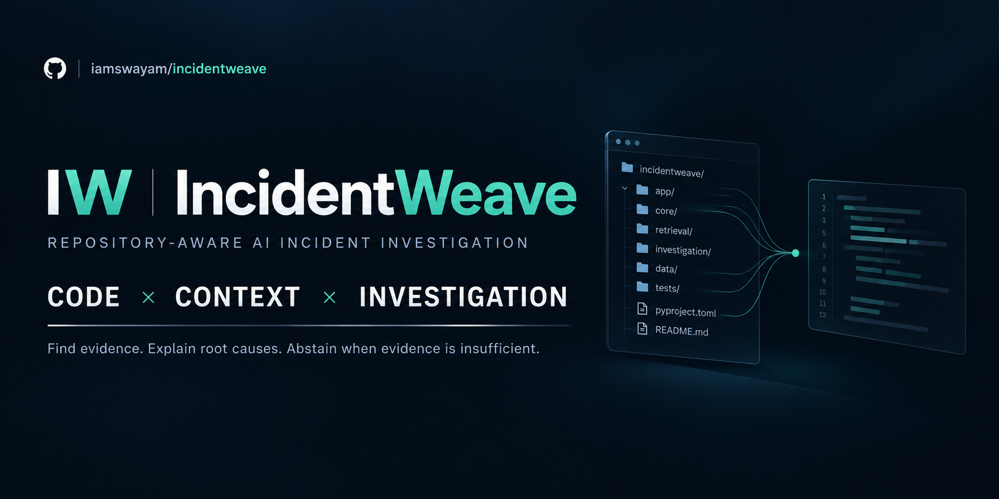
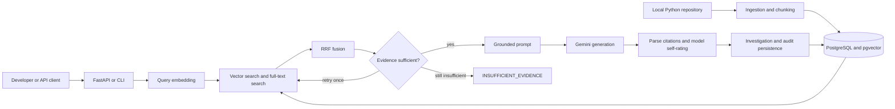

<div align="center">

# IncidentWeave

### Evidence-first investigation for local Python repositories

[](https://github.com/iamswayam/incidentweave/actions/workflows/ci.yml)


*A backend/AI engineering project that retrieves repository evidence before asking an LLM to explain an incident.*

[Quick start](#quick-start) · [Architecture](#architecture) · [Evaluation](#evaluation) · [Documentation](#documentation)



</div>

---

## Why IncidentWeave

An investigation answer is only useful when its evidence can be inspected. IncidentWeave indexes a **local Python repository**, retrieves relevant source chunks with vector and full-text search, checks whether the evidence is sufficient, and only then requests a grounded Gemini response.

It is deliberately a bounded system rather than an open-ended agent loop:

- Retrieval is repository-scoped and carries file paths, line ranges, scores, and chunk IDs through the workflow.
- The workflow retries retrieval once with a wider limit, then returns `INSUFFICIENT_EVIDENCE` if evidence is still insufficient.
- Generated, sufficient-evidence investigations persist an `Investigation` plus an `Audit` record with retrieved evidence metadata and tool attempts.
- The project includes a pinned-corpus evaluation harness, PostgreSQL-backed integration tests, Ruff, Docker, and GitHub Actions CI.

> **Current scope:** IncidentWeave is a local, single-service portfolio project. It indexes Python source only; it is not a multi-user or production-hardened incident platform.

## Architecture



The graph executes hybrid retrieval in-process and does not invoke MCP tools. After one unsuccessful widened retrieval it returns `INSUFFICIENT_EVIDENCE`; the model does not choose tools. The MCP server module still exposes `grep_search` and `hybrid_search`, but neither is called by the investigation graph. See [HLD](docs/architecture/02-high-level-design.md) and [LLD](docs/architecture/03-low-level-design.md) for the implementation-level design.

## What’s implemented

| Capability | Implementation |
|---|---|
| **Repository ingestion** | Traverses eligible local `*.py` files, excludes VCS/cache/tool directories, and creates non-redundant 60-line chunks with 10-line overlap. Chunks matching supported secret patterns are skipped with a warning; re-ingestion replaces chunks for the same repository name. |
| **Embeddings** | Calls Gemini `gemini-embedding-001`, requests 768 dimensions, validates the vector length, and stores it in `VECTOR(768)`. |
| **Hybrid retrieval** | Combines pgvector cosine-distance results with PostgreSQL full-text results through Reciprocal Rank Fusion (RRF). |
| **Evidence gate** | Requires at least one retrieved chunk with vector distance at or below the provisional 0.5 cutoff; RRF is for ranking and reporting, not a gate. A chunk without vector distance cannot make evidence sufficient. The cutoff will be re-validated on the held-out split in checklist item 3b. |
| **Grounded generation** | Sends retrieved source content, paths, line ranges, and scores inside tagged, explicitly untrusted evidence sections to Gemini `gemini-3.5-flash-lite`; evidence content is bounded by the prompt budget. |
| **Citations & model self-rating** | Extracts citations to retrieved chunk IDs/file paths and may lower the model's `high` self-rating when retrieval margins are borderline. The rating is not a measured probability of correctness. |
| **Audit trail** | Persists an investigation and audit for answers, guard refusals, model abstentions, and failures; the investigation stores a typed outcome, and refusals retain retrieval evidence and tool attempts. |
| **API & tooling** | Protected HTTP endpoints, local CLI entry points, a stdio MCP server, Docker Compose, Alembic migrations, pytest, Ruff, and CI. |

## Technology stack

| Area | Technologies |
|---|---|
| Backend | Python 3.12+, FastAPI, Pydantic Settings, Uvicorn |
| Data | PostgreSQL 17, pgvector, SQLAlchemy async, Psycopg 3, Alembic |
| AI & workflow | Gemini embeddings and generation, LangGraph, MCP |
| Search | pgvector cosine distance, PostgreSQL FTS, Reciprocal Rank Fusion |
| Engineering | Docker Compose, pytest, Ruff, GitHub Actions |

## Quick start

### Prerequisites

- Python 3.12 or 3.13
- Docker Desktop / Docker Compose
- A Gemini API key for embedding, search, and investigation commands

### 1. Install and configure

```powershell
git clone https://github.com/iamswayam/incidentweave.git
cd incidentweave

python -m venv .venv
.\.venv\Scripts\Activate.ps1
python -m pip install --upgrade pip
pip install -e ".[dev]"

Copy-Item .env.example .env
```

Set `GEMINI_API_KEY` and `API_PROTECTION_SECRET` in `.env`. The API launcher reads `.env`; embedding and investigation CLI commands read `GEMINI_API_KEY` from the process environment, so set it in your shell before using those commands:

```powershell
$env:GEMINI_API_KEY = "<your-gemini-api-key>"
$env:API_PROTECTION_SECRET = "<a-local-shared-secret>"
```

### 2. Start PostgreSQL and apply the schema

```powershell
docker compose up -d db
alembic upgrade head
```

### 3. Index a repository

```powershell
python scripts\ingest_repo.py <repo_path> <repository_name>
python scripts\embed_chunks.py <repository_name>
```

`<repository_name>` is the database identifier used by search and investigation. Re-running ingestion for the same name replaces that repository’s chunks. Only Python files are indexed.

### 4. Search or investigate

```powershell
# Inspect ranked source evidence without generation or persistence.
python scripts\search_repo.py <repository_name> "How are database sessions configured?" --limit 5

# Run the full grounded workflow and persist a generated sufficient-evidence result.
python scripts\investigate.py <repository_name> "How are database sessions configured?" `
  --limit 5
```

## API

Start the service after configuring `.env` and starting PostgreSQL:

```powershell
# Windows: uses a Psycopg-compatible selector event loop.
python scripts\serve.py
```

On Linux/macOS, the standard development command is:

```bash
uvicorn app.main:app --reload
```

| Route | Auth | Purpose |
|---|---|---|
| `GET /health` | None | Returns `{"status": "ok"}`. |
| `POST /investigations` | `X-API-Secret` | Runs a synchronous investigation and persists its outcome, including refusals and failures. |
| `GET /investigations/{id}` | `X-API-Secret` | Returns the persisted investigation plus reconstructed audit details. |
| `GET /repositories` | `X-API-Secret` | Lists repositories with total and embedded chunk counts. |

```powershell
$headers = @{ "X-API-Secret" = $env:API_PROTECTION_SECRET }

Invoke-RestMethod -Method Post `
  -Uri "http://127.0.0.1:8000/investigations" `
  -Headers $headers `
  -ContentType "application/json" `
  -Body '{"repository_name":"<repository_name>","query":"How are database sessions configured?","limit":5}'
```

The API and CLI report the diagnosis and model self-rating (`low`, `medium`, or `high`). The API also includes a rating note: it is the model's own label, may be lowered when retrieval scores are weak, and is not a measured probability of correctness; no accuracy check exists yet. API responses include the outcome, cited chunk IDs, the evidence check, tool attempt trace, model, latency, and a fixed evaluation caveat. Guard refusals are persisted with an investigation ID and retrieval evidence; errors store only their exception class name.

## Evaluation

The evaluation harness compares vector-only, full-text-only, and hybrid retrieval; records guard decisions; and performs two end-to-end passes against a pinned source snapshot. It uses a 24-question golden set:

- 8 direct answerable questions
- 8 paraphrased answerable questions
- 4 far-unanswerable questions
- 4 near-unanswerable questions

Run it with:

```powershell
python scripts\run_eval.py --help
```

The recorded Phase 8 baseline on the pinned 70-chunk snapshot found vector and hybrid retrieval tied at hit@1 `8/16`, hit@3 `11/16`, hit@5 `11/16`, and MRR `0.573`; full-text was empty for 14 of 16 answerable questions. The guard recorded 16 true accepts, 0 false refusals, 4 true refusals, and 4 false accepts.

These are diagnostic measurements, **not a general benchmark**: the set covers one source snapshot, labels are pending maintainer review, and answer screening uses keywords rather than human or LLM-judge adjudication. Full methodology, artifacts, and limitations are in [Phase 8](docs/phases/08-evaluation.md) and [Phase 8b](docs/phases/08b-evaluation-improvements.md).

## Quality checks and CI

```powershell
ruff check .
pytest
pytest tests\unit
pytest tests\integration  # requires PostgreSQL + pgvector
```

GitHub Actions runs on pushes and pull requests. It installs Python 3.12 dependencies, starts `pgvector/pgvector:pg17`, checks database connectivity, applies Alembic migrations, runs Ruff and pytest, and builds the Docker image. See [CI configuration](.github/workflows/ci.yml).

## Project structure

```text
incidentweave/
├── app/
│   ├── api.py                 # HTTP routes and response models
│   ├── api_security.py        # shared-secret and local rate limiter
│   ├── db/                    # async session, ORM models
│   ├── investigation/         # graph, guard, prompt, generation, parsing, audit
│   └── retrieval/             # vector, FTS, and RRF hybrid search
├── scripts/                   # ingest, embed, search, investigate, serve, eval CLIs
├── evaluation/                # golden set, metrics, runner, stored artifacts
├── migrations/                # Alembic schema history
├── tests/                     # unit and PostgreSQL integration tests
├── docker/                    # application image
└── docs/                      # architecture, phase logs, reviews, learning notes
```

## Known limitations

IncidentWeave intentionally makes its current boundaries visible:

- **Source coverage:** it indexes local Python files only; it does not yet ingest other languages, docs/runbooks, configuration, logs, traces, or live operational systems.
- **Chunking and retrieval:** chunks are fixed line windows. There is no AST-aware chunking, reranker, pgvector ANN index, or persisted FTS/GIN index in the current schema.
- **Evidence and model self-rating:** citations establish that the response referred to retrieved IDs/paths; they do not independently prove every claim. The self-rating is the model's own label with retrieval-based downgrade logic, not a measured probability of correctness.
- **Evaluation:** the current evaluation is useful for regression-oriented diagnosis but is small, repository-specific, and pending label review.
- **Service security:** protected routes use one shared secret and an in-memory per-IP limiter. There are no user accounts, key rotation, per-user quotas, distributed limiting, or production deployment controls.
- **Audit completeness:** answers, guard refusals, model abstentions and investigation errors are persisted with an outcome. Refusals retain retrieval evidence and a reason for historical API reads; errors store only the exception class name. The database does not retain the pre-calibration model label for historical API reads.

## Documentation

| Document | Contents |
|---|---|
| [Architecture](docs/architecture/README.md) | Architecture reference and design documents. <br>↳ [High-Level Design](docs/architecture/02-high-level-design.md) <br>↳ [Low-Level Design](docs/architecture/03-low-level-design.md) |
| [Phase build logs](docs/phases/README.md) | Nine-phase task specifications and verification logs. |
| [Architecture review](docs/architecture-review/README.md) | Independent audits of the project and the prioritized fix checklist. |
| [Chunking experiment](docs/chunking-experiment/README.md) | Chunking-strategy experiment record and independent reviews. |
| [Learning notes](docs/learning/README.md) | Interview-oriented summaries of major concepts. |
| [Notes](docs/notes/README.md) | Manual verification and deferred optimization notes. |

## Roadmap status

The approved project roadmap contains nine phases: setup, persistence, ingestion, retrieval, investigation, grounding, controlled tools/audit, evaluation, and production CLI/API. **All nine phases are complete; Phase 9 is the final phase on the current roadmap.**

---

<div align="center">

Built as a personal backend and AI engineering portfolio project by [@iamswayam](https://github.com/iamswayam).

</div>
