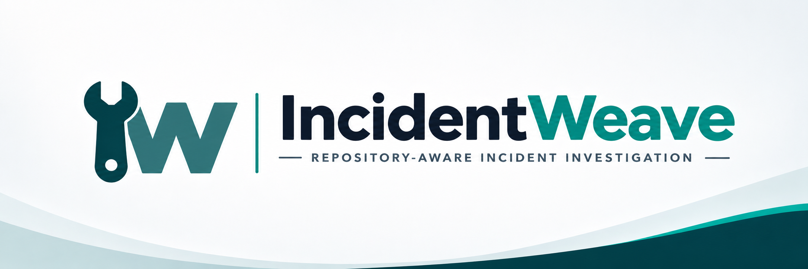
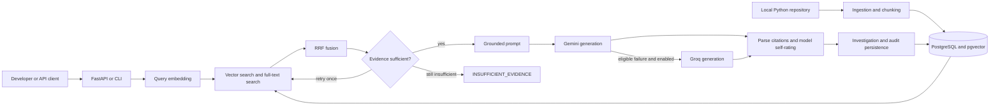

 <div align="center">



[](https://github.com/iamswayam/incidentweave/actions/workflows/ci.yml)


*Evidence-grounded incident investigation for code repositories. Retrieve the relevant source, verify the facts, and investigate with citations instead of guesswork.*

[Overview](#overview) · [Architecture](#architecture) · [Quick start](#quick-start) · [API](#api) · [Evaluation](#evaluation) · [Documentation](#documentation)
</div>

## Overview

IncidentWeave helps developers and engineers investigate repository incidents with grounded evidence.

It indexes a local Python repository, retrieves evidence using hybrid search, checks whether the evidence is sufficient, and only then asks an LLM to explain the incident.

Every answer is tied back to source evidence with citations, chunk metadata, and audit-friendly investigation records.

### Why this matters

- Investigations start from the repository itself, not from scattered memory or guesswork.
- Retrieval is hybrid: vector search and full-text search are fused before generation.
- A score-based evidence guard can abstain when retrieved evidence is insufficient. Its current weakness is rejecting questions that are close to, but not covered by, the indexed evidence.
- Outcomes are persisted for audit, replay, and downstream review.

IncidentWeave is designed as a bounded local service for repository-aware investigation work. It is not a multi-user production platform and should be evaluated with that scope in mind.

**Current focus:** improving retrieval ranking, near-miss refusal, and answer-quality evaluation before expanding the supported evidence sources.

## Architecture



Retrieval, guard, generation, parsing, and persistence run in a bounded workflow; the model does not choose tools. The MCP server exposes local search tools, but the investigation graph does not invoke them. See the [High-Level Design](docs/architecture/02-high-level-design.md) and [Low-Level Design](docs/architecture/03-low-level-design.md).

Groq is an explicitly enabled, default-off generation fallback after eligible Gemini availability failures; embeddings remain Gemini-only. Enabling it sends repository snippets and incident text to a second vendor. Review the [Groq fallback note](docs/notes/13-groq-generation-fallback.md) and current provider data terms first.

## Results at a glance

Provisional v1 development results (not held-out); the full scorecard and definitions are in the [metrics reference](docs/reference/metrics.md).

| Measure | Result | 95% interval | n |
|---|---:|---|---:|
| Hit@5 | 28/33 | [0.691, 0.933] | 33 |
| MRR@5 | 0.674 | [0.543, 0.800] | 33 |
| False-accept rate | 6/15 | [0.198, 0.643] | 15 |
| Near-miss refusal rate | 0/6 | [0.000, 0.390] | 6 |
| Guard AUROC | 0.893 | [0.790, 0.976] | 48 |

These results are development measurements, not evidence of production readiness. In particular, the current near-miss refusal result shows that the guard still needs improvement.

## Quick start

### Prerequisites

- Python 3.12 or 3.13
- Docker Desktop / Docker Compose
- A Gemini API key for embedding, search, and investigation

### Install and configure

```powershell
git clone https://github.com/iamswayam/incidentweave.git
cd incidentweave
winget install --id=astral-sh.uv -e
uv sync --all-extras
.\.venv\Scripts\Activate.ps1
Copy-Item .env.example .env
```

Use the activated `.venv` for project commands. Add runtime dependencies with `uv add <package>` and development dependencies with `uv add --dev <package>`; do not use `pip install` inside the project. The `local-embeddings` extra supports the registered local embedding study. CI installs from the committed `uv.lock` with `uv sync --locked`.

Set `GEMINI_API_KEY` and `API_PROTECTION_SECRET` in `.env`. Embedding and investigation commands also need `GEMINI_API_KEY` in the process environment:

```powershell
$env:GEMINI_API_KEY = "<your-gemini-api-key>"
$env:API_PROTECTION_SECRET = "<a-local-shared-secret>"
```

### Start the database and index a repository

```powershell
docker compose up -d db
alembic upgrade head
python -m scripts.ingest_repo <repo_path> <repository_name>
python -m scripts.embed_chunks <repository_name>
```

The repository name is the database identifier used by search and investigation. Re-ingestion replaces that repository’s chunks. Only Python files are indexed.

### Search or investigate

```powershell
python -m scripts.search_repo <repository_name> "How are database sessions configured?" --limit 5
python -m scripts.investigate <repository_name> "How are database sessions configured?" --limit 5
```

## API

Start the service after configuring `.env` and starting PostgreSQL:

```powershell
python -m scripts.serve
```

| Route | Auth | Purpose |
|---|---|---|
| `GET /health` | None | Returns `{"status": "ok"}`. |
| `GET /ui` | None | Opens the local maintainer evaluation interface. |
| `POST /investigations` | `X-API-Secret` | Runs an investigation and persists its outcome. |
| `GET /investigations` | `X-API-Secret` | Lists paginated, content-free investigation summaries. |
| `GET /investigations/{id}` | `X-API-Secret` | Returns the investigation and reconstructed audit details. |
| `GET /repositories` | `X-API-Secret` | Lists repositories with total and embedded chunk counts. |

### Investigation listing filters

`GET /investigations` supports these query parameters:

| Parameter | Required | Purpose |
|---|---|---|
| `repository_name` | No | Filters investigations by repository name. |
| `limit` | No | Maximum number of records to return; defaults to `20`, range `1–100`. |
| `before_id` | No | Returns records older than the supplied investigation ID. |

### Example request

```powershell
$headers = @{ "X-API-Secret" = $env:API_PROTECTION_SECRET }
Invoke-RestMethod -Method Post `
  -Uri "http://127.0.0.1:8000/investigations" `
  -Headers $headers `
  -ContentType "application/json" `
  -Body '{"repository_name":"<repository_name>","query":"How are database sessions configured?","limit":5}'
```

Detailed response, audit, and replay behavior is documented in the [API design](docs/architecture/03-low-level-design.md#8-api-design).

## Evaluation

Offline retrieval uses committed fixtures and cached query embeddings; answer evaluation runs the investigation pipeline. The reports are regression-oriented and repository-specific.

The current v1 development dataset contains 33 answerable and 15 unanswerable questions. It is not a held-out benchmark, and its labels and answer-quality measurements have limitations.

See the [evaluation guide](evaluation/README.md), [repository data cards](evaluation/repos/README.md), and [dataset protocol](docs/architecture-review/15-evaluation-dataset-protocol.md) for methods, data, artifacts, and limits. The provisional v1 development retrieval and guard results are in the [metrics reference](docs/reference/metrics.md).

## Quality checks

```powershell
python -m scripts.test_tiers fast
python -m scripts.test_tiers integration
python -m scripts.test_tiers evaluation
python -m scripts.test_tiers full
```

Integration requires PostgreSQL and migrations; evaluation runs the deterministic harness and offline retrieval smoke gate. CI separates lint/build, unit, PostgreSQL integration, and evaluation jobs. See the [test-tier guide](docs/notes/16-test-tiers.md).

## Project structure

```text
incidentweave/
├── app/
│   ├── db/             # Database models and session management
│   ├── investigation/  # Investigation workflow
│   ├── providers/      # External model provider integrations
│   ├── retrieval/      # Repository retrieval
│   ├── web/            # Static maintainer evaluation UI
│   ├── api.py          # HTTP API routes
│   ├── api_security.py # API access protection
│   ├── config.py       # Application configuration
│   └── main.py         # FastAPI application
├── scripts/            # Ingestion, embedding, search, investigation, and evaluation CLIs
├── evaluation/         # Manifest, questions, fixtures, baselines, and experiments
├── migrations/         # Alembic schema history
├── tests/              # Unit, integration, and evaluation tiers
├── docker/             # Application image
└── docs/               # Architecture, reviews, phases, and notes
```

## Known limitations

- **Source coverage:** local Python files only; no logs, traces, runbooks, other languages, or live operational systems.
- **Retrieval:** fixed line-window chunks; no AST-aware chunking, reranker, pgvector ANN index, or persisted FTS/GIN index.
- **Evidence:** citations validate that a quote exists in retrieved text, not that it entails the claim. Model self-rating is not a probability of correctness. The evidence guard is score-based and does not prove semantic relevance.
- **Evaluation:** results are small, repository-specific, and pending label review; they do not establish general performance. Current near-miss refusal performance is a known weakness.
- **Security:** one shared API secret and an in-memory per-IP limiter; no accounts, key rotation, per-user quotas, or distributed limiting.

## Documentation

| Document | Contents |
|---|---|
| [Architecture](docs/architecture/README.md) | Architecture overview and design documents. |
| [Vision and roadmap](docs/architecture/05-vision-and-roadmap.md) | Project vision, principles, roadmap horizons and scope fence. |
| [Live fix checklist](docs/architecture-review/03-fix-checklist.md) | Current project status and approved work. |
| [Evaluation](evaluation/README.md) | Evaluation commands, data, and artifact lifecycle. |
| [Repository data](evaluation/repos/README.md) | Dataset composition, attribution, and labelling guidance. |
| [Phases](docs/phases/README.md) | Phase specifications and verification history. |
| [Architecture review](docs/architecture-review/README.md) | Audits, protocols, and fix checklist. |
| [Notes](docs/notes/README.md) | Manual verification and deferred optimization notes. |
| [Documentation index](docs/README.md) | Cross-folder document status and experiment index. |
| [Scripts catalog](scripts/README.md) | Script purpose, side effects, requirements, and coverage. |

## License

MIT. See [LICENSE](LICENSE).
