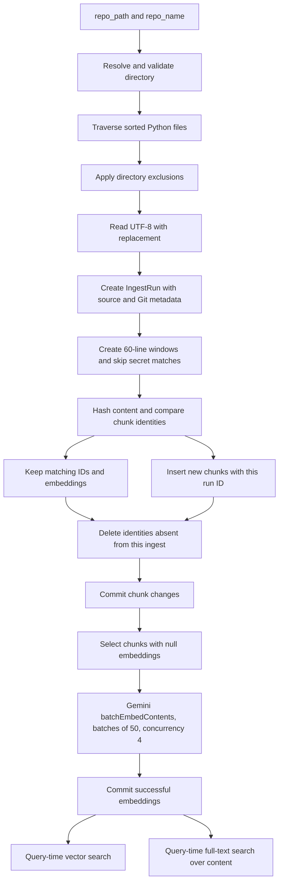
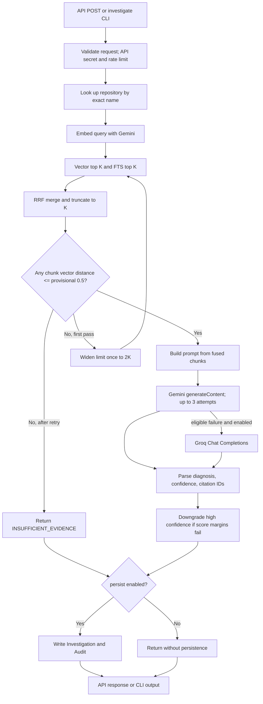

# IncidentWeave Architecture

**As of 2026-11-01.**

**Canonical repository:** [github.com/iamswayam/incidentweave](https://github.com/iamswayam/incidentweave)

IncidentWeave is a repository-aware AI incident investigation platform. Its purpose is to help an engineer investigate questions about a software repository by retrieving source evidence, presenting that evidence to a language model, and returning a diagnosis with references to retrieved chunks. The implemented workflow starts by ingesting Python source into PostgreSQL/pgvector, then accepts a query, searches the selected repository, applies a numeric evidence gate, widens retrieval once if needed, and either abstains or generates a response. With persistence enabled, answered, model-abstained, guard-refused, and error outcomes receive Investigation and Audit records.

**Implemented capability:** local Python repository ingestion, fixed-window chunking, async Gemini embeddings, Gemini-first generation with an optional Groq fallback, PostgreSQL vector and full-text retrieval, RRF fusion, a score-based evidence guard, one widened retrieval retry, shared response parsing, categorical confidence downgrading, and replayable Investigation/Audit persistence. The HTTP API exposes investigation and repository-read endpoints; ingestion and chunk embedding remain CLI operations.

The current investigation path checks a persistent query-embedding cache before calling Gemini. The cache stores a vector and a hash of the normalized, case-preserved query (never query text), expires rows after 30 days, and caps the table at 10,000 rows. A typed embedding-availability failure after a confirmed cache miss uses the registered sanitized-OR lexical query only; it returns metadata-only evidence with a null/not-evaluated guard and never generates an answer. Exhausted generation availability failures after ordinary hybrid retrieval and guard acceptance return the separate `generation_unavailable` response. Both degraded outcomes are explicit, persisted, and reconstructed by `GET /investigations/{id}`. See the [degraded-response implementation record](../architecture-review/13-degraded-response-design.md).

**Intended goal versus guarantee:** the prompt and citations are intended to keep investigations evidence-oriented. The implementation does not verify that every answer claim is entailed by cited content, and the evidence guard does not check semantic relevance. Evaluation results are small-sample diagnostics, not evidence of general accuracy or reliability. This document makes no claim that the system is production-ready or eliminates unsupported model output.

This is a source-grounded reference, not authorization to change the architecture. It distinguishes implemented code, test coverage, saved measurements, inference, and behavior not verified at runtime.

**Evidence labels:** **Source-verified** means explicit in current source. **Tested** means an automated test covers the behavior (test execution is separately stated). **Artifact-observed** means present in a saved evaluation artifact. **Inferred** means follows from code wiring but was not directly exercised. **Unknown** means the repository or available runtime evidence does not establish the behavior.

**Inspected revision:** `e104005848bdee38d603d3703f93a5ff9bce79e1`, branch `phase-8/evaluation`, inspected 2026-10-17. At inspection, the local branch and stored `origin/phase-8/evaluation` ref matched. The working tree had an existing untracked `evaluation/results/run-2.json`; ignored evaluation artifacts were also present. No remote fetch was performed. The source permalinks below target this inspected commit; their public availability depends on that commit being present on GitHub. This architecture document was created after that revision check.

The deep source inventory and source permalinks below remain anchored to that inspected
revision. The current-behavior summary and change history have been refreshed through
2026-11-01; verify later implementation details against the current source.

## How to Verify This Architecture

1. Check the checkout you are actually using with `git status --short --branch` and `git rev-parse HEAD`; do not assume the local branch matches GitHub. The revision above is the revision inspected for this document, not a promise about a later checkout.
2. Follow the local relative source links to inspect the implementation. The absolute GitHub links in section 14 point to the recorded commit SHA; they resolve publicly only if that commit has been pushed and is accessible.
3. A test's presence establishes test coverage, not that the test passed in your environment. Run the relevant test command and record its output before calling behavior tested. Test execution for the current implementation change is reported separately; no live provider or deployed-runtime behavior is implied.
4. For an evaluation report, compare its `code_sha` to the evaluated source revision and its `pinned_sha` to the corpus commit. Also inspect `code_dirty`, `code_untracked_files`, `golden_set_sha256`, model, thresholds, prompt hash, pass files, and configuration metadata. Matching a report's code SHA alone does not reproduce provider behavior.
5. Evaluation caches, run reports, snapshots, and other local or ignored artifacts may not be included in the public repository. Their local presence is not evidence that another checkout or GitHub has them. Use only artifacts available in the checkout being reviewed, and mark missing evidence as unknown.

## 1. System Overview

The two principal paths connect indexed repository content to a user investigation. Ingestion stores Python source chunks and their embeddings in PostgreSQL/pgvector. A query is embedded and searched against one named repository using vector and PostgreSQL full-text retrieval; RRF combines their rankings before the evidence guard decides whether to proceed, retry once, or abstain. Guard-accepted content is placed in a prompt for the configured generation provider. When persistence is enabled, answers, model abstentions, guard refusals and pipeline errors are recorded with audit metadata.

**Source-verified:** The application uses Python 3.12+, FastAPI, SQLAlchemy async sessions, PostgreSQL, pgvector, LangGraph, MCP, and `httpx.AsyncClient` for Gemini REST calls. The shared provider client keeps the API key in a header, retries selected transient failures with jitter, and applies request deadlines. Evaluation code is outside `app/` and calls the investigation pipeline with persistence disabled.

**Observed scope:** The ingestion CLI handles `*.py` only. The API exposes investigation and repository-read endpoints, not ingestion or embedding endpoints. Markdown, runbooks, SOPs, logs, background jobs, and other document ingestion are not implemented by the inspected ingestion path.

**Verification status:** Source behavior is described from the inspected code. Test coverage is identified separately; this document update did not execute tests. Saved evaluation values are labeled artifact-observed. Database, deployed-service, and provider behavior remains unverified unless a cited saved artifact records it.

## 2. Component and Module Responsibilities

| Component | Responsibility and key implementation |
|---|---|
| `scripts/ingest_repo.py` | Selects a local root and repository name, records an IngestRun, and upserts chunks by content hash. [`iter_python_files`](../../scripts/ingest_repo.py#L35), [`chunk_lines`](../../scripts/ingest_repo.py#L49), [`ingest_repository`](../../scripts/ingest_repo.py#L93). |
| `scripts/embed_chunks.py` | Embeds chunks that have no vector through Gemini `embedContent`; handles each chunk independently and commits after iteration. [`embed_text`](../../scripts/embed_chunks.py#L38), [`embed_repository_chunks`](../../scripts/embed_chunks.py#L77). |
| `app/db/models/` and `migrations/` | Define Repository, Chunk, IngestRun, Investigation, and Audit storage. [Models](../../app/db/models/), [initial migration](../../migrations/versions/20260819_0001_initial_schema.py#L16), [ingest-run migration](../../migrations/versions/20261025_0003_ingest_runs.py). |
| `app/retrieval/vector_search.py` | Top-K pgvector cosine-distance query scoped by repository ID. [`search_vector`](../../app/retrieval/vector_search.py#L11). |
| `app/retrieval/fulltext_search.py` | Normal query-time PostgreSQL full-text filtering and ranking. [`search_fulltext`](../../app/retrieval/fulltext_search.py#L9). |
| `app/retrieval/degraded_search.py` | C1 sanitized-OR lexical retrieval used only after typed embedding availability failure and confirmed cache miss; no vector guard or generation follows. [`search_degraded_lexical_only`](../../app/retrieval/degraded_search.py). |
| `app/retrieval/hybrid_search.py` | Runs both retrievers, combines rankings with reciprocal-rank fusion (RRF), and returns fused top-K. [`hybrid_search`](../../app/retrieval/hybrid_search.py#L9). |
| `app/retrieval/query_embedding_cache.py` | Persistent exact-key query-vector cache: 30-day TTL, 10,000-row cap, and model/task/dimension/query-hash identity. [`get_query_embedding`](../../app/retrieval/query_embedding_cache.py), [`put_query_embedding`](../../app/retrieval/query_embedding_cache.py). |
| `app/db/models/query_embedding_cache.py` and migration `0006` | Store the vector and SHA-256 query hash without query text; indexes support the unique cache identity and oldest-first expiry. [Model](../../app/db/models/query_embedding_cache.py), [migration](../../migrations/versions/20261031_0006_query_embedding_cache.py). |
| `app/investigation/graph.py` | LangGraph orchestration: retrieval, guard, one widening retry, insufficient-evidence return, prompt, generation, parse, and calibration. [`create_investigation_graph`](../../app/investigation/graph.py#L94). |
| `app/investigation/guard.py` | Score-based evidence gate; it does not inspect golden labels or prove semantic relevance. [`evaluate_evidence_sufficiency`](../../app/investigation/guard.py#L11). |
| `app/investigation/mcp_server.py` | Exposes `hybrid_search` and `grep_search` MCP tools; the investigation graph does not invoke this server. [`grep_search_tool`](../../app/investigation/mcp_server.py#L99). |
| `app/investigation/prompt.py`, `generation.py`, `parsing.py`, `confidence.py` | Build evidence prompt, request schema-constrained JSON from Gemini, validate claim citations against retrieved chunk IDs and whitespace-normalized quotes, and downgrade confidence where score margins are weak. Citation validity does not establish claim faithfulness. [`build_grounded_prompt`](../../app/investigation/prompt.py#L20), [`generate_investigation`](../../app/investigation/generation.py#L30), [`parse_investigation_response`](../../app/investigation/parsing.py#L118), [`calibrate_confidence`](../../app/investigation/confidence.py#L9). |
| `app/investigation/persistence.py` | Stores parsed diagnosis and audit metadata when the pipeline's `persist` flag permits it. [`persist_investigation`](../../app/investigation/persistence.py#L11). |
| `scripts/investigate.py`, `app/api.py`, `app/main.py` | CLI/pipeline entry and synchronous HTTP API. [`investigate_repository`](../../scripts/investigate.py#L42), [API routes](../../app/api.py#L68), [FastAPI app and error handlers](../../app/main.py#L1). |
| `evaluation/`, `scripts/run_eval.py` | Pinned-corpus validation, retrieval and end-to-end measurement, per-question traces, reports, and run comparison. [`run_evaluation`](../../evaluation/runner.py#L715), [`compare_reports`](../../evaluation/compare.py#L77). |

**MCP distinction:** The server exposes both `hybrid_search` and `grep_search`, but the investigation graph does not call either MCP tool. Hybrid search is imported and called directly ([graph retrieval](../../app/investigation/graph.py#L100)); the future of the MCP module is deferred to checklist item 25.

## 3. Ingestion and Indexing Flow

1. **Repository selection — Source-verified.** `python -m scripts.ingest_repo <repo_path> <repo_name>` takes a filesystem path and a separate database identity. It resolves the path and requires an existing directory. It looks up or creates a `Repository` by exact name; each ingestion run stores the resolved source path ([argument parsing](../../scripts/ingest_repo.py#L169), [`ingest_repository`](../../scripts/ingest_repo.py#L93)).
2. **Traversal and formats — Source-verified.** Traversal is sorted `rglob("*.py")`. Excluded path components are `.git`, `.kilo`, `.pytest_cache`, `.ruff_cache`, `.venv`, `__pycache__`, and `migrations` ([`IGNORE_DIRS`](../../scripts/ingest_repo.py#L24), [`iter_python_files`](../../scripts/ingest_repo.py#L35)). No Markdown, log, PDF, or other format parser is present in this path. Files are decoded as UTF-8 with replacement.
3. **Parsing and chunking — Source-verified.** No AST or syntax parser is used. `chunk_lines` creates 60-line windows with 10-line overlap (step 50), skips windows that add no new lines, and discards blank-only content ([`chunk_lines`](../../scripts/ingest_repo.py#L49), chunk construction at [line 101](../../scripts/ingest_repo.py#L101)). Python slices use an exclusive end index; the code stores that index as `line_end`, which is the inclusive, one-based number of the final included source line.
4. **Metadata and provenance — Source-verified.** Each run records resolved `source_path`, available Git remote/commit/dirty state, and `chunker_version="lines-60-10-v1"`. Remote URL userinfo is removed before storage. Each eligible Chunk receives its SHA-256 `content_hash`, repository ID, relative POSIX path, line bounds, and file/document type; structural metadata remains unset ([IngestRun model](../../app/db/models/ingest_run.py), [Chunk model](../../app/db/models/chunk.py)).
5. **Upsert and deletion behavior — Source-verified.** Chunk identity is `(repository_id, file_path, line_start, line_end, content_hash)`. Matching chunks retain their IDs and embeddings; new identities are inserted with the current run ID, and identities absent from the new ingest are deleted ([`ingest_repository`](../../scripts/ingest_repo.py#L93), [migration](../../migrations/versions/20261025_0003_ingest_runs.py)). Removed chunk text is not archived, so historical evidence text is preserved only after checklist item 8.
6. **Embedding generation — Source-verified.** Run separately with `python -m scripts.embed_chunks <repo_name>`. It selects rows with null embeddings, batches them through Gemini `batchEmbedContents` in groups of 50, requests `outputDimensionality=768`, validates each response vector, casts values to float, and assigns the vectors. At most four batches run concurrently; failed batches are reported and counted while successful batches are committed at the end ([model and dimension](../../scripts/embed_chunks.py), [`embed_texts`](../../scripts/embed_chunks.py), [`embed_repository_chunks`](../../scripts/embed_chunks.py)). Requests use the shared async provider client with retries for selected transient failures. The optional Gemini `task_type` parameter is experimental; production calls omit it pending the registered development comparison in [note 14](../notes/14-embedding-task-type-experiment.md).
7. **FTS preparation — Source-verified.** No FTS column/vector is created during ingestion. Search computes `to_tsvector('english', content)` and `websearch_to_tsquery(query)` at request time and orders by `ts_rank_cd` ([`search_fulltext`](../../app/retrieval/fulltext_search.py#L9)).

**Evaluation-specific exception:** `evaluation/runner.py::setup_eval_corpus` inserts pinned-snapshot chunks into one strategy-specific allowlisted evaluation repository using ranges from `evaluation/chunk_strategies.py`. If that repository already exists, its path/range/content tuples must exactly match the selected snapshot and strategy or setup fails without replacing rows. Matching rows are reused; only missing embeddings are submitted for embedding. The production `scripts.ingest_repo.chunk_lines` function is not patched or called by this evaluation setup. The inventory guard permits count changes only in the selected evaluation repository and rejects changes, creation, or disappearance elsewhere ([`setup_eval_corpus`](../../evaluation/runner.py#L274), [`ensure_non_eval_inventory_unchanged`](../../evaluation/runner.py#L241), [strategy definitions](../../evaluation/chunk_strategies.py)).

**Tests:** `tests/unit/scripts/test_ingest_repo.py` covers chunk windows, remote credential stripping, and secret skipping. `tests/integration/ingestion/test_ingest_repo_integration.py` covers stable IDs/embeddings, changed and removed chunks, run records, and audit linkage. `tests/evaluation/test_evaluation.py` checks pinned snapshot counts. These tests cover the listed cases only; path containment for symlinks and provider failure behavior are not established by them. Run the documented [test tiers](../notes/16-test-tiers.md) for fast, integration, and offline evaluation checks.

## 4. User-Query Investigation Flow

1. **Entry points — Source-verified.** The investigation CLI is `python -m scripts.investigate <repo_name> <query> [--limit N]`; `scripts/search_repo.py` is a separate hybrid-search-only CLI. HTTP routes are `POST /investigations`, `GET /investigations/{id}`, `GET /repositories`; `/health` is open ([routes](../../app/api.py#L26), [health and error handlers](../../app/main.py#L1)).
2. **Validation and authentication — Source-verified.** The Pydantic request requires repository name length 1-255, query length 1-2000, and limit 1-20 (default 5); the prompt evidence-content budget is 24,000 characters. Protected routes require `X-API-Secret`, compare against configured secret with `secrets.compare_digest`, then apply a 10-request/60-second per-client-IP in-memory sliding window ([request model](../../app/api.py#L26), [input limits](../../app/investigation/limits.py), [`require_api_access`](../../app/api_security.py#L57)).
3. **Repository and query embedding — Source-verified.** `investigate_repository` finds the exact repository row, obtains its ID, asynchronously embeds the query using the embedding script, and starts the graph with initial limit `limit` and retry limit `2 * limit`. The embedding-plus-graph work has a 120-second deadline ([`investigate_repository`](../../scripts/investigate.py)).
4. **Retrieval and guard — Source-verified.** Graph retrieval calls `hybrid_search` for the selected database repository. Guard checks scores and appends an attempt record. If sufficient, the graph builds a prompt; if insufficient on first search it widens; if insufficient after widening it returns `INSUFFICIENT_EVIDENCE` without generation ([graph routing](../../app/investigation/graph.py#L164)).
5. **Prompt and generation — Source-verified.** The prompt includes the query plus each hybrid result's ID, path, line range, scores, and content. It tells the model to use only supplied repository evidence and to return `INSUFFICIENT_EVIDENCE` if unsupported ([`SYSTEM_INSTRUCTION`](../../app/investigation/prompt.py#L7), [`build_grounded_prompt`](../../app/investigation/prompt.py#L20)). After guard acceptance, Gemini is tried first with a 90-second generation deadline; the default-off Groq fallback is available only for configured transient Gemini failures.
6. **Parsing, calibration, response — Source-verified.** The parser extracts diagnosis, the model's self-rating, and cited IDs; retrieval calibration may lower a `high` self-rating to `medium`. The CLI labels the value `Model self-rating`; the API exposes it as `model_self_rating` with a note that it is not a measured probability of correctness. After guard acceptance, exhausted availability failures return additive `generation_unavailable` fields and content-free evidence metadata; the CLI prints the degraded state and safe trace summary ([response model](../../app/api.py#L34), [graph](../../app/investigation/graph.py), [CLI](../../scripts/investigate.py)).
7. **Persistence — Source-verified.** API POST passes `persist=True`; the investigation CLI defaults to `True`. Evaluation passes `False`. Answered, model-abstained, guard-refused, `generation_unavailable`, and graph/embedding error outcomes each attempt an Investigation and Audit write when persistence is enabled. Degraded audit JSONB stores flags, content-free evidence, guard result, and provider failure trace; its trace and tool-call parameters omit prompt and query text, source text, model output, and keys. Audit replay fields are never included in API response models ([pipeline persistence branches](../../scripts/investigate.py#L90), [`persistence.py`](../../app/investigation/persistence.py)).

## 5. Mermaid Diagram: Ingestion

## 6. Mermaid Diagram: Investigation

## 7. Database Schema and Data Lifecycle

| Entity | Important fields and relationships |
|---|---|
| `repositories` | Integer ID, unique non-null name (255 chars), created/updated timestamps. One repository has chunks and investigations. [Model](../../app/db/models/repository.py#L17). |
| `chunks` | Repository FK with `ON DELETE CASCADE`; nullable IngestRun FK with `ON DELETE SET NULL`; content hash, file path, line bounds, metadata, nullable `VECTOR(768)`. B-tree indexes include a unique identity on repository/path/range/content hash. [Model](../../app/db/models/chunk.py#L17), [migration](../../migrations/versions/20261025_0003_ingest_runs.py). |
| `ingest_runs` | Repository FK with `ON DELETE CASCADE`; source path, sanitized Git remote, commit SHA, dirty state, start time, chunker version, optional embedding model. [Model](../../app/db/models/ingest_run.py). |
| `investigations` | Repository FK, query, parsed diagnosis in `response`, model, latency, token usage, final model self-rating, outcome, optional error class, timestamp; index on repository ID. [Model](../../app/db/models/investigation.py#L17). |
| `audit_records` | Investigation and repository FKs; optional IngestRun FK; integer array of retrieved chunk IDs; parallel score arrays; JSONB tool trace; nullable prompt/version, raw response/self-rating, generation settings, thresholds, embedding model, per-chunk snapshots and minimal execution trace; model, parsed diagnosis, latency, token count, confidence, feedback. No chunk FK for elements of `retrieved_chunk_ids`. [Model](../../app/db/models/audit.py#L17). |

Migrations `20260819_0001_initial_schema`, `20261024_0002_investigation_outcome`, `20261025_0003_ingest_runs`, and `20261026_0004_replayable_audit` create the schema. The ingestion migration adds provenance, backfills chunk content hashes, and establishes the chunk identity index; the replay migration adds nullable audit fields. SQLAlchemy sessions are configured through `AsyncSessionLocal` in [app/db/session.py](../../app/db/session.py#L1). PostgreSQL full-text indexes are not declared in these migrations.

## 8. Retrieval, RRF, Evidence Guard, Retry and Abstention

- **Vector — Source-verified:** pgvector cosine distance, ascending, repository-scoped, excludes null embeddings; top K from `search_vector` ([implementation](../../app/retrieval/vector_search.py#L11)).
- **Full text — Source-verified:** `websearch_to_tsquery` filters English `to_tsvector` content and ranks by `ts_rank_cd`; top K ([implementation](../../app/retrieval/fulltext_search.py#L9)). Query lexemes are not guaranteed to match code tokens; the Phase 8 log observed many empty results.
- **RRF — Source-verified:** for each chunk, sum `1 / (60 + rank)` over the vector and FTS lists where the chunk appears. Shared chunks get both contributions. Sort descending and return K ([fusion](../../app/retrieval/hybrid_search.py#L21)). Numeric source scores are not averaged.
- **Guard — Source-verified:** evidence is sufficient when at least one retrieved chunk has a vector distance `<= 0.5`. RRF is used for ranking and reporting, not as a gate; a result without a vector distance cannot make evidence sufficient ([guard](../../app/investigation/guard.py)). The cutoff is provisional and will be re-validated on the held-out split in checklist item 3b.
- **Widening — Source-verified:** if the initial result is insufficient, one retry doubles requested K. A vector-only closest distance will not improve merely because K grows; RRF membership can change. This is an implication of the ranking query, not a separate live measurement.
- **Retry and abstention — Source-verified:** after an insufficient widened result, the graph returns `INSUFFICIENT_EVIDENCE` without generation. The MCP server separately exposes literal `grep_search`; the investigation graph does not call it.
- **MCP — Source-verified:** `app.investigation.mcp_server` exposes `hybrid_search` and `grep_search` tools over stdio, but neither is invoked by the investigation graph. The graph calls `hybrid_search` in-process.

## 9. LLM Integration, Prompting, Parsing and Confidence

- **Provider/model — Source-verified:** Gemini `gemini-3.5-flash-lite` is the primary generation model. When explicitly enabled and configured, `app/investigation/generation.py` tries Groq Chat Completions after Gemini rate-limit, server, or timeout errors, including an open Gemini cooldown. Groq has a separate adapter, retry budget, limiter, cooldown, and `GROQ_TIMEOUT_SECONDS`; the graph reports the selected model. The Groq fallback is off by default and embeddings remain on Gemini ([generation](../../app/investigation/generation.py), [Gemini provider](../../app/providers/gemini.py), [Groq provider](../../app/providers/groq.py)). No explicit sampling parameters are sent by default. Generation latency measures the full provider call, including retries.
- **Prompt — Source-verified:** retrieved hybrid chunks are included with ID, file path, line bounds, vector/FTS/RRF scores, and content inside `<evidence>` tags. Closing-tag prefixes in content are escaped; system instructions treat tagged content as untrusted data. Evidence content is capped at 24,000 characters, with lowest-ranked results dropped and an oversized first result truncated ([prompt](../../app/investigation/prompt.py#L7)).
- **Ingestion secret scan — Source-verified:** each nonblank chunk is checked against supported API-key/token/private-key/assignment patterns before storage; a matching chunk is skipped and only its pattern name, relative path, and line range are warned. This regex screen can miss secrets.
- **Parsing — Source-verified:** first candidate text is parsed as JSON under the shared generation response schema: `outcome`, `diagnosis`, `self_rating`, `uncertainty_note`, and `claims` with evidence `chunk_id` and `quote`. Groq output is normalized into the same candidate envelope and schema-checked before entering the graph. Invalid JSON and incorrectly typed fields raise `ModelOutputError`. The server retains a claim only when it has at least one evidence quote whose chunk ID was retrieved and whose quote is at least 10 characters and occurs case-sensitively after whitespace normalization. A declared insufficient-evidence outcome or no surviving claim yields `INSUFFICIENT_EVIDENCE`; the effective rating is forced to `low` while the model's raw `self_rating` and valid claims are preserved. Invalid evidence entries are dropped, and `cited_chunk_ids` comes from validated claims ([parser](../../app/investigation/parsing.py)).
- **Citation validity — Source-verified:** the parser counts submitted and valid references and returns a validity rate; evaluation aggregates that rate separately from label-based citation relevance. A matching quote proves only that the reference is present in retrieved text, not that it supports the claim ([parser](../../app/investigation/parsing.py#L117), [citation metrics](../../evaluation/metrics.py#L156)).
- **Provider schema mode — Source-verified:** generation sends `responseMimeType: application/json` and the response schema using the documented Gemini REST format. No live Gemini request was made to validate the provider behavior in this change.
- **Confidence — Source-verified:** only `high` may be downgraded, to `medium`, when RRF is below `0.032` or best vector distance exceeds `0.4`; there is no upgrade path ([calibrator](../../app/investigation/confidence.py#L9)).
- **Secrets and errors — Source-verified:** Gemini reads `GEMINI_API_KEY`; Groq reads `GROQ_API_KEY` through application settings and is attempted only when `GROQ_FALLBACK_ENABLED=true` and `GROQ_MODEL` is set. Fallback logging includes only the classified reason and provider transition, never prompt/response content or keys. API errors avoid returning raw internal messages. Request and input-validation `ValueError`s map to 422, repository-not-found to 404, typed provider failures (including malformed upstream query embeddings) to 502, and unexpected errors to generic 500. Only exhausted generation `rate_limited`, `server_error`, or `timeout` typed failures return the degraded HTTP 200 contract; auth, bad-request, safety-blocked, and schema-invalid errors stay explicit ([route](../../app/api.py#L68), [exception handlers](../../app/main.py#L15)).

## 10. Audit, Citations, Abstention and Persistence

- **Generated result:** `persist_investigation` reparses the provider response and stores the parsed diagnosis, model, latency, token count and final self-rating in Investigation and Audit rows; the Investigation stores either `answered` or `abstained_model` as its outcome. Audit also stores the exact prompt and version, raw candidate text, raw self-rating before calibration, generation settings, thresholds, embedding model, a ranked per-chunk hash/location/score snapshot with kept status, and a correlation/outcome/model/generation-latency/error-class trace. The exact prompt preserves evidence text the model saw; per-chunk records identify content by hash and source location rather than copying it ([persistence](../../app/investigation/persistence.py), [ReplayRecord](../../app/investigation/replay.py)).
- **Guard refusal:** if the graph remains insufficient after the widened retry, it returns `INSUFFICIENT_EVIDENCE`; with `persist=True`, one Investigation (`refused_guard`) and Audit row preserve the refusal reason, retrieval snapshot and thresholds. A refusal has no prompt or raw response. Evaluation uses `persist=False` and does not write these rows.
- **Investigation error:** exceptions during embedding or graph execution are re-raised after an `error` outcome and an Audit row are attempted when `persist=True`. The trace records the failed stage and model when known, typed provider error classes and attempt metadata, and never the exception message.
- **Replay limitations and access:** exact prompts and raw candidate text may contain proprietary repository source. These audit fields are stored in PostgreSQL but omitted from POST and GET API responses; database access must remain restricted. Per-chunk records do not copy content; dropped chunks and refusal evidence require the corresponding source revision to remain available. Successful investigations record generation latency; degraded/error traces add timing for the failed provider stage.
- **Evaluation persistence:** `run_pipeline_once` calls the same investigation function with `persist=False` and captures compact generation metadata for measurement; it does not request Investigation/Audit writes ([runner](../../evaluation/runner.py#L320)).
- **API response:** POST returns investigation ID, diagnosis, outcome, `model_self_rating`, a `rating_note`, validated claims and quotes, uncertainty note, citation-validation counts, cited chunk IDs, evidence check, retry flag, tool calls, model, latency, and a static note summarizing Phase 8 ([response model](../../app/api.py#L34)). The additive `unavailable_answer`, `degraded`, `degraded_reason`, and metadata-only `evidence` fields default to `false`, `false`, `null`, and `[]`; GET reconstructs degraded fields from audit JSONB and old records receive the defaults. `generation_unavailable` has no diagnosis, claims, or citations and returns the guard result plus locations/scores only. Error class is not exposed. `/repositories` returns total and embedded chunk counts.

## 11. Evaluation Architecture and Available Results

**Evaluation flow — Source-verified:** `evaluation/repos/incidentweave/questions.json` pins a corpus SHA and 24 labeled questions (8 direct, 8 paraphrased, 4 far-unanswerable, 4 near-unanswerable). `run_evaluation` exports that commit, validates source labels and index reachability, selects an explicitly allowlisted evaluation repository, computes independent vector/FTS/hybrid retrieval metrics, then runs two pipeline passes with `persist=False`. The evaluation-only strategies are `baseline` (60/10, `incidentweave-eval`, default) and `w100_o20` (100/20, `incidentweave-eval-w100_20`). Expected chunk ranges are computed from the selected strategy. New evaluation repositories receive evaluation-owned chunk rows; existing repositories are reused only when all path/range/content tuples match, otherwise setup fails closed without deleting or replacing data. It writes `pass-1.json`, `pass-2.json`, and `report.json` under a strategy-specific run ID. Report metadata records code/corpus SHAs, tracked dirty state, untracked file count, models, thresholds, prompt hash, strategy, chunk size, overlap, evaluation repository, and config hash ([questions](../../evaluation/repos/incidentweave/questions.json#L1), [`run_evaluation`](../../evaluation/runner.py#L715), [strategy definitions](../../evaluation/chunk_strategies.py), [corpus export](../../evaluation/corpus.py#L25)). The `w100_o20` harness is implemented in the current working tree but remains uncommitted; no experiment run is authorized by this implementation task.

**Metrics — Source-verified:** Retrieval hit@1/3/5 and MRR use file-path plus case-insensitive label substring. Guard confusion counts answerability vs guard sufficiency. The keyword answer screen requires one term from each `must_mention` group; it is not human correctness or claim grounding. V2 outcomes add guard refusal, model abstention, retrieval miss, labeled/unlabeled context pass, incomplete/wrong, and error. Citation summary checks cited chunks against the same labels. Generation traces capture raw text, prompt hash/length, finish reason, usage, latency, throttle wait, and HTTP call counts ([metrics](../../evaluation/metrics.py), [runner records](../../evaluation/runner.py#L451)).

**Available artifacts — Artifact-observed:** Legacy [baseline.json](../../evaluation/results/baseline.json), [run-2.json](../../evaluation/results/run-2.json), and [evaluation_report.json](../../evaluation/results/evaluation_report.json), plus six timestamped run bundles, each with report and two pass files:

| Run ID | Reported code SHA | `code_dirty` / untracked count |
|---|---|---|
| `20261005T143011Z-abe7796` | `abe77967b5ae9635bff486303cdddd44b0b28e2c` | true |
| `20261005T150844Z-fea9d8d` | `fea9d8d2b2eb2e31ac9f6e674b566766ed4748ae` | true |
| `20261005T151632Z-fea9d8d` | `fea9d8d2b2eb2e31ac9f6e674b566766ed4748ae` | true |
| `20261005T152746Z-2a6c658` | `2a6c658636e9f0e8d77933f3d899cff1b37e3d03` | true |
| `20261014T160330Z-305200f` | `305200f223f4c0bdea61519e5ff5c7bfd2903e7c` | false; 1 untracked |
| `20261015T151657Z-c203e0e` | `c203e0e3fac87340addfe905ce3bd17eacfbe35f` | false; 1 untracked |

All six timestamped runs report corpus SHA `62d0e58593bb22d187ec7930274b0457afd3be74`, 40 files/70 chunks, embedding model `models/gemini-embedding-001`, generation model `gemini-3.5-flash-lite`, limit 5, and provider-default generation settings. The golden set is still marked `pending maintainer review`. Historical runs do not all use the same code revision or clean tracked tree.

**Latest saved run, 2026-10-15 — Artifact-observed:** On 16 answerable questions, vector and hybrid both have hit@1/3/5 `8/11/11`, MRR `0.5729167`; full-text has `1/1/2`, MRR `0.078125`, and is empty for 14/16. Guard counts are 16 true accepts, 0 false refusals, 4 true refusals, 4 false accepts. Per pass, V2 counts are 10 `correct_labeled_context`, 2 `correct_unlabeled_context`, 2 `retrieval_miss_abstained`, 2 `incomplete_or_wrong`, 4 `guard_true_refusal`, and 4 `model_abstained`. Reported calls: 40, with 0 HTTP 429s and 0 generation errors. Citation label-match summaries are 9/22 cited chunks in pass 1 and 9/31 in pass 2 ([latest report](../../evaluation/results/runs/20261015T151657Z-c203e0e/report.json)). These are diagnostic measurements on this small, pending-review set, not a general benchmark.

**Interpretation and limitations:** Vector and hybrid metrics tie in these reports; this does not show a retrieval gain from fusion. Legacy `outcome` counts are not comparable to V2 because legacy labels generated responses to unanswerable questions as “falsely answered,” including model abstentions. Model outcomes vary across passes/runs. The saved reports omit explicit generation parameters/provider version. Per-question pass records preserve fused hybrid results, not standalone vector and full-text rankings, limiting exact retrieval replay. `outcome_changes` uses the legacy field, and `compare_reports` question-level flips inspect pass 1 only ([runner comparison generation](../../evaluation/runner.py#L850), [compare code](../../evaluation/compare.py#L18)). Config fingerprints have no explicit schema version.

**Reproduction status:** The report includes useful provenance, but full reproduction from saved artifacts alone is **not established**: standalone per-question retrieval lists, provider-version/config details, and a checked-in materialized snapshot are absent. Evaluation tests and historical run outputs are documented in [Phase 8](../phases/08-evaluation.md) and [Phase 8b](../phases/08b-evaluation-improvements.md); tests were not run while updating this document. Run folders and caches are ignored locally, so they may not be available in a public checkout.

## 12. Configuration, Deployment and External Dependencies

- **Configuration — Source-verified:** `app/config.py` uses Pydantic Settings with `.env` and environment variables for app environment, database URL, Gemini key, and API protection secret ([Settings](../../app/config.py#L1)). Do not put secret values in this document. Generation and embedding functions read `GEMINI_API_KEY` from the process environment.
- **Database/deployment — Source-verified:** Compose defines PostgreSQL `pgvector/pgvector:pg17` and an app service on port 8000, with a DB health dependency ([compose](../../docker-compose.yml#L1)). The Dockerfile copies `app/`, `scripts/`, `alembic.ini`, and `migrations/` ([Dockerfile](../../docker/Dockerfile#L1)). No migration was run as part of this documentation task.
- **Launch — Source-verified:** `scripts/serve.py` starts Uvicorn and configures a selector event loop on Windows; `app/main.py` also sets the Windows selector policy before app import ([launcher](../../scripts/serve.py#L1), [app entry](../../app/main.py#L1)).
- **Dependencies — Source-verified:** FastAPI, Pydantic Settings, Uvicorn, SQLAlchemy async, psycopg, pgvector, Alembic, LangGraph, MCP, and `httpx` are runtime dependencies ([dependency list](../../pyproject.toml#L1)). Evaluation uses standard-library JSON/hash/process functions and existing application packages.
- **API protection — Source-verified:** Shared-secret header plus per-process IP limiter; source comments explicitly state this is not production-grade authentication and limiter state is not shared across workers ([security module](../../app/api_security.py#L1)).
- **Documentation drift:** `docs/notes/02-deferred-optimizations.md` still says the Docker image omits `scripts/`, while the current Dockerfile copies it ([note](../notes/02-deferred-optimizations.md#L130), [Dockerfile](../../docker/Dockerfile#L12)).

## 13. Known Limitations and Failure Modes

- Ingestion accepts Python files only; fixed line windows can split semantic units. No AST-aware or document-format parsing is implemented.
- Re-ingestion replaces all chunks for a repository and can change chunk IDs; there is no incremental update or chunk uniqueness key.
- Embedding uses batches of 50 with concurrency capped at 4; these and the provider deadlines are initial defaults, not throughput guarantees. The first live benchmark and its limits are recorded in [the benchmark note](../notes/03-embedding-benchmark.md); one run is indicative only, and no throughput promise is made from it.
- FTS query-time parsing may return no rows for natural-language questions; there is no FTS index in the declared migration.
- Hybrid RRF treats list ranks equally and has no explicit deterministic tie-break. The evidence guard does not require relevant source content; its vector-distance cutoff is provisional and does not establish semantic relevance.
- The MCP server still exposes a local literal grep tool, but the investigation graph does not invoke it. Checklist item 25 addresses whether the MCP module should remain.
- Provider-default generation settings are not pinned in the report. Batch size 50, concurrency 4, and the 90-second generation / 120-second investigation deadlines are initial defaults. The first live embedding benchmark is recorded in [the benchmark note](../notes/03-embedding-benchmark.md); one run is indicative only, and no throughput promise is made from it.
- Citation matching is a reference detector, not claim verification. Confidence is a categorical model label subject only to a one-way threshold downgrade.
- API limiter is in-memory and per worker; no user accounts, key rotation, or per-user quota. API has no ingestion/embedding endpoint or background queue.
- README overstates both grounding protection and raw-response persistence ([README](../../README.md#L169), [persistence](../../app/investigation/persistence.py#L25)).
- Phase 8b status text is inconsistent: the header and reviewer blocks indicate approval while its evidence bundle contains “awaiting reviewer” wording ([Phase 8b](../phases/08b-evaluation-improvements.md#L3)).
- No live database, deployed-container, provider, or current remote behavior was verified for this document. Automated tests were not run.

## 14. Source-Code Reference Index

| Area | Primary source references |
|---|---|
| Configuration and session | [app/config.py](../../app/config.py), [app/db/session.py](../../app/db/session.py) |
| Schema and migration | [app/db/models/repository.py](../../app/db/models/repository.py), [chunk.py](../../app/db/models/chunk.py), [investigation.py](../../app/db/models/investigation.py), [audit.py](../../app/db/models/audit.py), [initial migration](../../migrations/versions/20260819_0001_initial_schema.py) |
| Ingestion and embeddings | [scripts/ingest_repo.py](../../scripts/ingest_repo.py), [scripts/embed_chunks.py](../../scripts/embed_chunks.py) |
| Retrieval | [vector_search.py](../../app/retrieval/vector_search.py), [fulltext_search.py](../../app/retrieval/fulltext_search.py), [hybrid_search.py](../../app/retrieval/hybrid_search.py) |
| Investigation and grounding | [graph.py](../../app/investigation/graph.py), [guard.py](../../app/investigation/guard.py), [prompt.py](../../app/investigation/prompt.py), [generation.py](../../app/investigation/generation.py), [parsing.py](../../app/investigation/parsing.py), [confidence.py](../../app/investigation/confidence.py), [mcp_server.py](../../app/investigation/mcp_server.py), [persistence.py](../../app/investigation/persistence.py) |
| Entry points and security | [scripts/investigate.py](../../scripts/investigate.py), [scripts/search_repo.py](../../scripts/search_repo.py), [scripts/serve.py](../../scripts/serve.py), [app/api.py](../../app/api.py), [app/api_security.py](../../app/api_security.py), [app/main.py](../../app/main.py) |
| Evaluation | [questions.json](../../evaluation/repos/incidentweave/questions.json), [chunk_strategies.py](../../evaluation/chunk_strategies.py), [runner.py](../../evaluation/runner.py), [metrics.py](../../evaluation/metrics.py), [golden.py](../../evaluation/golden.py), [corpus.py](../../evaluation/corpus.py), [compare.py](../../evaluation/compare.py), [run_eval.py](../../scripts/run_eval.py), [compare_runs.py](../../scripts/compare_runs.py) |
| Tests inspected | [unit tests](../../tests/unit/), [integration tests](../../tests/integration/) |
| Project configuration/deployment | [pyproject.toml](../../pyproject.toml), [docker-compose.yml](../../docker-compose.yml), [Dockerfile](../../docker/Dockerfile), [alembic.ini](../../alembic.ini) |

### GitHub Source Permalinks

These links use the inspected commit SHA. They point to source files, not local evaluation artifacts. GitHub can resolve them only if the commit is available in the remote repository.

- [Repository ingestion](https://github.com/iamswayam/incidentweave/blob/e104005848bdee38d603d3703f93a5ff9bce79e1/scripts/ingest_repo.py) and [embedding](https://github.com/iamswayam/incidentweave/blob/e104005848bdee38d603d3703f93a5ff9bce79e1/scripts/embed_chunks.py)
- [Vector retrieval](https://github.com/iamswayam/incidentweave/blob/e104005848bdee38d603d3703f93a5ff9bce79e1/app/retrieval/vector_search.py), [full-text retrieval](https://github.com/iamswayam/incidentweave/blob/e104005848bdee38d603d3703f93a5ff9bce79e1/app/retrieval/fulltext_search.py), and [RRF fusion](https://github.com/iamswayam/incidentweave/blob/e104005848bdee38d603d3703f93a5ff9bce79e1/app/retrieval/hybrid_search.py)
- [Investigation graph](https://github.com/iamswayam/incidentweave/blob/e104005848bdee38d603d3703f93a5ff9bce79e1/app/investigation/graph.py), [evidence guard](https://github.com/iamswayam/incidentweave/blob/e104005848bdee38d603d3703f93a5ff9bce79e1/app/investigation/guard.py), and [prompt](https://github.com/iamswayam/incidentweave/blob/e104005848bdee38d603d3703f93a5ff9bce79e1/app/investigation/prompt.py)
- [Gemini generation](https://github.com/iamswayam/incidentweave/blob/e104005848bdee38d603d3703f93a5ff9bce79e1/app/investigation/generation.py), [parsing and citations](https://github.com/iamswayam/incidentweave/blob/e104005848bdee38d603d3703f93a5ff9bce79e1/app/investigation/parsing.py), [confidence](https://github.com/iamswayam/incidentweave/blob/e104005848bdee38d603d3703f93a5ff9bce79e1/app/investigation/confidence.py), and [persistence](https://github.com/iamswayam/incidentweave/blob/e104005848bdee38d603d3703f93a5ff9bce79e1/app/investigation/persistence.py)
- [HTTP API](https://github.com/iamswayam/incidentweave/blob/e104005848bdee38d603d3703f93a5ff9bce79e1/app/api.py), [evaluation runner](https://github.com/iamswayam/incidentweave/blob/e104005848bdee38d603d3703f93a5ff9bce79e1/evaluation/runner.py), and [evaluation metrics](https://github.com/iamswayam/incidentweave/blob/e104005848bdee38d603d3703f93a5ff9bce79e1/evaluation/metrics.py)

## 15. Architecture Change History

This history is assembled from the checked-in phase logs and current repository evidence. Entries without a commit are phase-level provenance, not claims about exact commit boundaries.

| Date / revision | Change represented in current architecture | Evidence and rationale recorded |
|---|---|---|
| Phase 2; migration `20260819_0001` | Added PostgreSQL entities for repositories, chunks, investigations, and audit records, including pgvector storage. | [Initial migration](../../migrations/versions/20260819_0001_initial_schema.py); phase log [database persistence](../phases/02-database-persistence.md). |
| Phase 3 | Added Python repository traversal, 60/10 line chunking, and replace-on-reingest behavior. | [Ingest implementation](../../scripts/ingest_repo.py); [Phase 3 log](../phases/03-ingestion-chunking.md). |
| Phase 4 | Added Gemini 768-dimensional embeddings, vector search, PostgreSQL FTS, and RRF fusion. | [Embedding](../../scripts/embed_chunks.py), [retrieval](../../app/retrieval/), [Phase 4 log](../phases/04-embeddings-retrieval.md). The phase log records per-chunk processing and no automatic retries. |
| Phases 5-7 | Added investigation graph, score guard/confidence calibration, controlled tools/MCP, and audit persistence. | [Graph](../../app/investigation/graph.py), [Phase 5-7 logs](../phases/05-investigation-engine.md). Phase logs describe intent and verification at their time; current source is authoritative for behavior today. |
| Phase 8 | The original phase snapshot used 24 questions and a pinned 40-file/70-chunk corpus to record diagnostic retrieval/guard outcomes; these are historical, not current evaluation-set counts. | [Phase 8 log](../phases/08-evaluation.md), [questions](../../evaluation/repos/incidentweave/questions.json). Its own scope states results are small-sample diagnostics, not a general benchmark. |
| Phase 8b; commits recorded in work log include `fea9d8d`, `2a6c658`, `b51894a`, `4b688a1` | Added generation traces, additive V2 outcomes, run metadata/registry/comparison, and report diagnostics while preserving legacy labels and evaluation `persist=False`. | [Phase 8b log](../phases/08b-evaluation-improvements.md). The document contains conflicting status wording noted above. |
| Phase 9 | Added synchronous FastAPI investigation/read endpoints, shared-secret protection, in-memory rate limit, and Docker runtime files. Ingestion and embedding remain CLI-only; job queue was explicitly deferred. | [API](../../app/api.py), [security](../../app/api_security.py), [Dockerfile](../../docker/Dockerfile), [Phase 9 log](../phases/09-production-api.md). |
| 2026-10-17; uncommitted evaluation harness on `experiment/chunking-evaluation-harness` | Added evaluation-only baseline 60/10 and experimental 100/20 strategies, separate allowlisted repositories, strategy-aware metadata/run IDs, evaluation-owned insertion for new corpora, exact-match reuse, fail-closed stale-data handling, and a selected-repository inventory guard. | D3/D4/D6 were approved in [the chunking experiment log](../chunking-experiment/01-experiment-log.md). This documents harness behavior only; the experiment has not been run or authorized. Production ingestion and golden-set data are unchanged. |
| 2026-10-17; source revision `e104005848bdee38d603d3703f93a5ff9bce79e1` | Created this implementation reference. No application, schema, dependency, test, or deployment behavior changed. | Current source and locally available evaluation artifacts inspected; runtime checks and test execution were not performed for the documentation update. |
| 2026-10-31; items 18d-2, 18d-3, and 18d-4 | Added explicit generation- and embedding-unavailable API outcomes, a persistent query-embedding cache, and the cache-miss lexical-only path. | [Degraded-response implementation record](../architecture-review/13-degraded-response-design.md), [API](../../app/api.py), [investigation entry point](../../scripts/investigate.py), [cache migration](../../migrations/versions/20261031_0006_query_embedding_cache.py). |

### Maintenance Rule

When an approved change affects application code, component responsibilities, execution flow, data models, APIs, configuration, dependencies, tests, evaluation, or deployment, update the relevant architecture sections in the same change. Update affected diagrams and source references, and add a dated change-history entry with the commit or pull request when available. Do not rewrite unrelated sections or change implementation merely to match this document. If a proposed change conflicts with a documented architectural decision, report the conflict and obtain an explicit decision before implementation. Distinguish test coverage from tests actually executed, and record runtime verification only when it was actually performed.