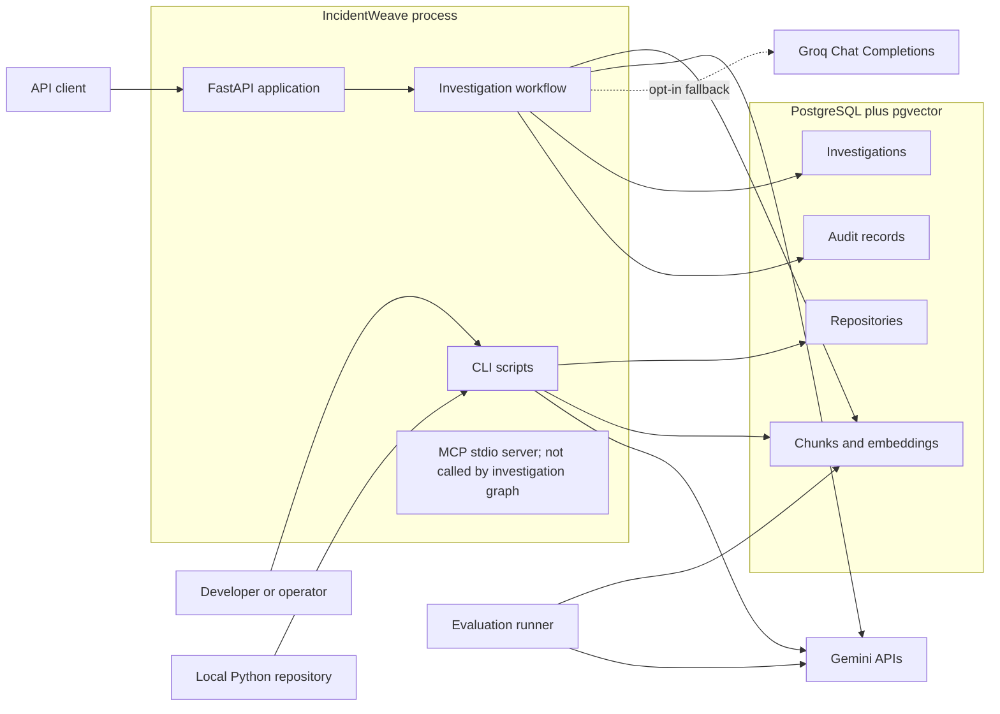
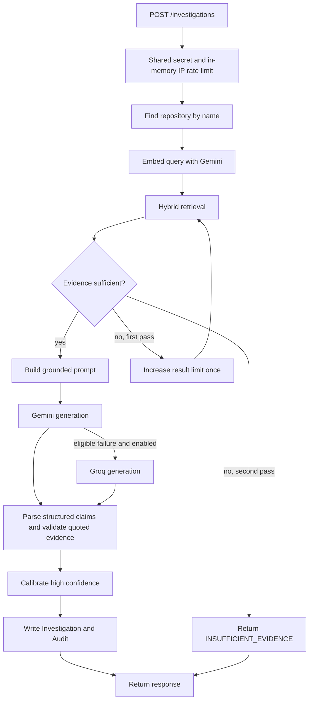
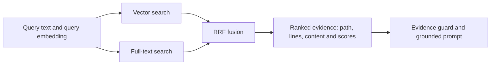

# IncidentWeave High-Level Design

**As of 2026-11-01.**

## 1. Purpose and documentation basis

IncidentWeave is a repository-aware investigation service for backend systems. It ingests a local Python repository, embeds source chunks, retrieves repository evidence for a natural-language question, and conditionally asks Gemini for an evidence-grounded diagnosis, with an optional default-off Groq generation fallback. With persistence enabled, generated answers, model abstentions, guard refusals, and pipeline errors are persisted with audit records.

This document describes the implementation on the `main` branch, not an aspirational redesign. The authoritative project-plan material present in the repository is the completed Phase 1–9 build-log series in [`docs/`](../README.md) and the [nine-phase roadmap](../../README.md#roadmap); the roadmap ends at Phase 9. No standalone project-plan or chat-roles document exists in the checked-out repository, so no absent document has been inferred.

## 2. Architectural goals implemented today

- Keep repository evidence ahead of generation: retrieval and an evidence-sufficiency check occur before model generation.
- Keep the service small: one FastAPI process and one PostgreSQL + pgvector database; provider calls remain direct REST calls with an optional Groq generation fallback.
- Keep workflow behavior bounded: one expanded-retrieval retry, then return `INSUFFICIENT_EVIDENCE` if evidence is still insufficient; the model does not choose tools.
- Persist answer, refusal, model-abstention, and error outcomes on Investigation rows, with corresponding Audit records.
- Provide local developer workflows and a CI pipeline that exercises PostgreSQL + pgvector, migrations, tests, linting, and Docker build.

## 3. Technology stack

| Layer | Implemented technology | Responsibility |
|---|---|---|
| API | Python 3.12, FastAPI, Uvicorn, Pydantic | HTTP validation, error shaping, health check, protected investigation/read APIs |
| Workflow | LangGraph | Bounded retrieval, guard, one retry, insufficient-evidence return, generation, parsing, calibration |
| AI | Gemini and optional Groq REST APIs | Gemini `gemini-embedding-001` embeddings (768 dimensions) and Gemini-first `gemini-3.5-flash-lite` generation; Groq is a configured, default-off generation fallback |
| Retrieval | pgvector cosine distance, PostgreSQL FTS, RRF | Vector and lexical candidate retrieval, rank fusion |
| Persistence | PostgreSQL 17 + pgvector, SQLAlchemy async, Psycopg 3, Alembic | Source chunks, investigation records, audit data and schema migration |
| Local tools | Model Context Protocol (MCP), stdio | MCP server exposes `grep_search` and `hybrid_search`; the investigation graph invokes neither |
| Quality/runtime | pytest tier commands, Ruff, GitHub Actions, Docker Compose | Network-blocked unit, PostgreSQL integration, and offline evaluation tests; lint and local container runtime ([test-tier guide](../notes/16-test-tiers.md)) |

Dependency ranges and Python version are defined in [`pyproject.toml`](../../pyproject.toml). The local Compose environment and Docker image are defined in [`docker-compose.yml`](../../docker-compose.yml) and [`docker/Dockerfile`](../../docker/Dockerfile).

## 4. Implemented system context



The evaluation runner uses the same retrieval/investigation implementation, but invokes it with `persist=False`; evaluation results are written as JSON files under `evaluation/results/runs/`, not as investigation/audit records. See [`evaluation/runner.py`](../../evaluation/runner.py).

## 5. Primary data flows

### 5.1 Repository ingestion and embedding

```mermaid
flowchart TD
    A[ingest_repo CLI: path and repository name] --> B[Resolve local directory]
    B --> C[Walk Python files, applying exclusions]
    C --> D[Create or find Repository]
    D --> E[Create IngestRun with source and available Git metadata]
    E --> F[Create 60-line chunks and skip supported secret patterns]
    F --> G[Hash content and compare path/range/hash identity]
    G --> H[Keep matching IDs and embeddings; add new identities]
    H --> I[Delete identities missing from the current ingest]
    I --> J[(chunks table)]
    J --> K
    K[embed_chunks CLI: repository name] --> L[Select chunks without embeddings]
    L --> M[Gemini batchEmbedContents: groups of 50, concurrency 4]
    M --> N[Validate 768 values]
    N --> O[Store VECTOR(768) embedding]
    O --> J
```

`scripts/ingest_repo.py` admits only `*.py` files and stores relative path, line range, file/document type, content hash, and the creating ingest-run ID. Each run records its resolved source path, available Git commit/dirty/remote metadata, and `chunker_version="lines-60-10-v1"`; remote URL userinfo is stripped. Before hashing, it skips nonblank chunks matching supported secret patterns and prints a warning with the pattern name and source location, never the match. Existing chunks with identical repository/path/range/hash identities keep their IDs and embeddings. New identities are inserted, and chunks absent from the latest ingest are deleted. The latter are not archived, so historical evidence text is preserved only after checklist item 8. `scripts/embed_chunks.py` processes only missing embeddings in batches of 50, runs at most four batches concurrently, reports failed batches, and commits successful embeddings after all batches finish.

Provider requests use an async HTTP client, bounded retries with jitter for selected transient failures, a 90-second generation deadline, and a 120-second end-to-end investigation deadline. Batch size 50, concurrency 4, and both deadlines are initial defaults. The first live embedding benchmark and its limits are recorded in [the benchmark note](../notes/03-embedding-benchmark.md); one run is indicative only, and no throughput promise is made from it.

The embedding helper supports optional Gemini retrieval task metadata, but current production calls omit it. Item 14a registers a separate development-only comparison of document `RETRIEVAL_DOCUMENT` and query `CODE_RETRIEVAL_QUERY`; do not change production defaults or reuse legacy cache entries before that comparison and an explicit adoption decision ([task-type experiment](../notes/14-embedding-task-type-experiment.md)).

### 5.2 Synchronous API investigation



The API handler delegates to [`scripts/investigate.py`](../../scripts/investigate.py). The graph executes hybrid search in-process and does not invoke the MCP server. The server module still exposes `grep_search` and `hybrid_search`; its future is deferred to checklist item 25 ([`app/investigation/graph.py`](../../app/investigation/graph.py), [`app/investigation/mcp_server.py`](../../app/investigation/mcp_server.py)).

### 5.3 Retrieval composition



Vector retrieval scopes by repository ID and orders by cosine distance. Full-text retrieval scopes by repository ID and uses `websearch_to_tsquery` against `to_tsvector('english', content)`. RRF adds `1 / (60 + rank)` for each result list in which a chunk appears. See [`app/retrieval/`](../../app/retrieval/).

## 6. External and operational boundaries

| Boundary | Implemented behavior |
|---|---|
| Local filesystem | Ingestion reads a supplied local directory and records its resolved source path plus available Git revision metadata in an IngestRun row. |
| Gemini | API key is read from `GEMINI_API_KEY` and sent in `x-goog-api-key`; asynchronous embedding and generation use REST over HTTPS with retry and deadline limits. |
| Groq | Optional generation-only fallback, disabled unless `GROQ_FALLBACK_ENABLED`, `GROQ_API_KEY`, and `GROQ_MODEL` are configured. It never handles embeddings. |
| PostgreSQL | The application converts a `postgresql://` URL to Psycopg’s async SQLAlchemy dialect, registers pgvector per connection, and uses async sessions. |
| HTTP | `/health` is open. `/investigations`, `/investigations/{id}`, and `/repositories` require `X-API-Secret`. |
| MCP | Local stdio subprocess only; there is no remote MCP deployment or model-directed tool selection. |
| Evaluation | Evaluation is a separate CLI process using a pinned source snapshot and a golden set; it protects its evaluation repository inventory and does not persist investigation rows. |

## 7. Scope boundaries and known limitations

The items below are current implementation facts, not planned components:

- **Python source only:** ingestion does not currently index non-Python code, Markdown/runbooks, configuration, logs, traces, or external operational systems.
- **Fixed line chunks:** the 60/10 line-window strategy does not use AST/symbol-aware chunking; structural metadata columns exist but ingestion sets `function_name`, `class_name`, and `symbol` to `None`.
- **Small-corpus retrieval posture:** the schema has B-tree repository/path indexes but no pgvector ANN index and no persisted/generated FTS vector with a GIN index. FTS computes `to_tsvector` at query time.
- **Bounded local workflow only:** after one widened retrieval retry, insufficient evidence returns `INSUFFICIENT_EVIDENCE`. The MCP server still exposes a grep tool, but the investigation graph does not invoke it.
- **Local-grade access control:** protected API routes use one shared secret and a process-local, per-IP limiter. There are no user accounts, key rotation, per-user quotas, or distributed rate-limit storage.
- **Outcome persistence:** answers, guard refusals, model abstentions, and embedding/graph errors persist `Investigation` and `Audit` rows when `persist=True`; the outcome is stored on the Investigation, and errors store only the exception class name.
- **No future component is assumed:** the approved README roadmap ends at Phase 9. Deferred options in existing documentation should not be read as implemented architecture.

## 8. Source map

| Concern | Primary source |
|---|---|
| HTTP app, routes, protection | [`app/main.py`](../../app/main.py), [`app/api.py`](../../app/api.py), [`app/api_security.py`](../../app/api_security.py) |
| Ingestion and embeddings | [`scripts/ingest_repo.py`](../../scripts/ingest_repo.py), [`scripts/embed_chunks.py`](../../scripts/embed_chunks.py) |
| Investigation boundary | [`scripts/investigate.py`](../../scripts/investigate.py) |
| Retrieval | [`app/retrieval/`](../../app/retrieval/) |
| Workflow, generation, prompts, parsing | [`app/investigation/`](../../app/investigation/) |
| Models and migration | [`app/db/models/`](../../app/db/models/), [`migrations/versions/20260819_0001_initial_schema.py`](../../migrations/versions/20260819_0001_initial_schema.py) |
| Evaluation | [`evaluation/`](../../evaluation/) and [`docs/phases/08-evaluation.md`](../phases/08-evaluation.md) |
| Build plan and verification history | [`docs/README.md`](../README.md) and [`README.md`](../../README.md) |
