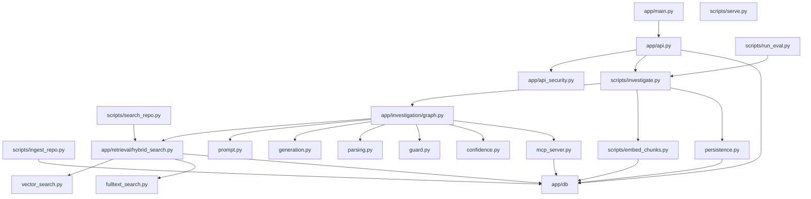
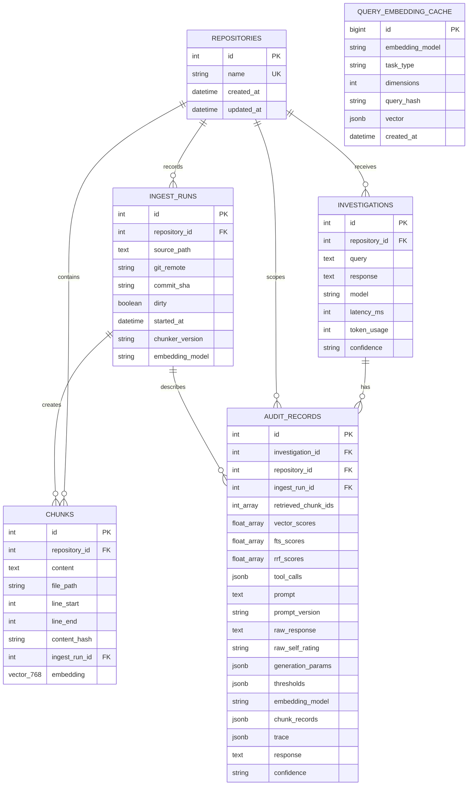
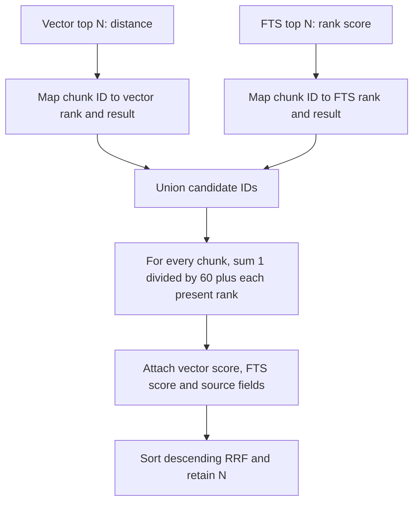
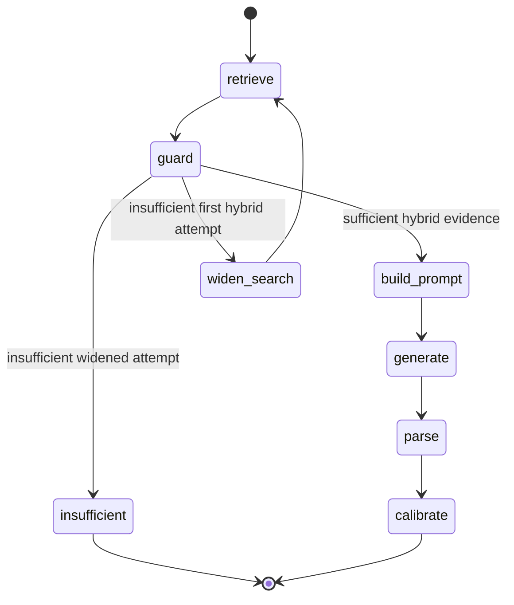
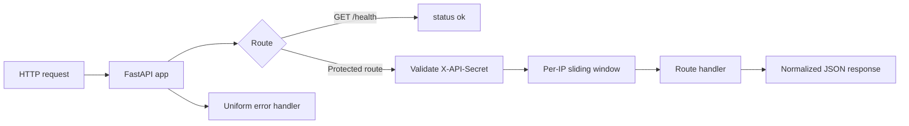

# IncidentWeave Low-Level Design

## 1. Scope and implementation status

This document records the low-level design implemented on the `main` branch. It is source-based: paths named here exist in the repository and diagrams model current runtime behavior. The Phase 1–9 build logs and [README roadmap](../../README.md#roadmap) are the in-repository plan baseline; the roadmap is complete at Phase 9. No standalone project-plan or chat-roles document was found in this checkout.

## 2. Package and entry-point map



| Entry point | Inputs | Output / responsibility |
|---|---|---|
| `app.main:app` | ASGI requests | Builds FastAPI, registers router and normalizes HTTP/validation/unexpected errors. |
| `scripts/serve.py` | None | Windows-safe Uvicorn launcher that selects `WindowsSelectorEventLoopPolicy` before loading the app. |
| `scripts/ingest_repo.py` | `<repo_path> <repo_name>` | Record an IngestRun and upsert the named repository’s source chunks by content identity, skipping chunks matching supported secret patterns. |
| `scripts/embed_chunks.py` | `<repo_name>` | Embed only chunks with null vectors; print embedded/failed/skipped counts. |
| `scripts/search_repo.py` | repository name, query, optional limit | Embed query, run hybrid search and print ranked evidence. |
| `scripts/investigate.py` | repository name, query, optional limit/path | Run full investigation graph; persist generated sufficient-evidence results by default. |
| `scripts/run_eval.py` | evaluation CLI options | Validate/evaluate pinned corpus and write run artifacts. |
| `app.investigation.mcp_server` | stdio MCP transport | Exposes local `hybrid_search` and `grep_search` tools; the investigation graph does not invoke them. |

## 3. Runtime configuration and database session

[`app/config.py`](../../app/config.py) defines `Settings` with `app_env`, `database_url`, `gemini_api_key`, and `api_protection_secret`. It loads `.env` using Pydantic Settings. Provider functions intentionally read `GEMINI_API_KEY` from the process environment.

[`app/db/session.py`](../../app/db/session.py) converts a plain PostgreSQL URL to `postgresql+psycopg://` when required, creates one async SQLAlchemy engine with `pool_pre_ping=True`, registers pgvector on each Psycopg connection, and exports `AsyncSessionLocal`. Callers open their own `async with AsyncSessionLocal()` blocks; there is also a `get_db_session()` generator.

## 4. Persistence design

### 4.1 Entity relationship model



Migrations `20260819_0001_initial_schema`, `20261024_0002_investigation_outcome`, `20261025_0003_ingest_runs`, `20261026_0004_replayable_audit`, `20261030_0005_provider_usage_log`, and `20261031_0006_query_embedding_cache` define the schema. The cache table has a unique identity over `(embedding_model, task_type, dimensions, query_hash)`, a creation-time index, and a positive-dimensions constraint; it has no query-text column or foreign key. `Chunk` contains additional nullable metadata fields (`file_type`, `document_type`, `symbol`, `function_name`, `class_name`, `section`, `service`, `environment`, `incident_id`, `timestamp`) that the current Python ingester does not populate except `file_type` and `document_type`.

### 4.2 Referential behavior and indexes

- `chunks.repository_id`, `investigations.repository_id`, `audit_records.repository_id`, and `ingest_runs.repository_id` use `ON DELETE CASCADE`; chunk/audit ingest-run references use `ON DELETE SET NULL`.
- ORM relationships cascade orphan deletion from repository to chunks/investigations and from investigation to audit records.
- Declared indexes include `chunks(repository_id)`, `chunks(repository_id, file_path)`, unique chunk identity, `ingest_runs(repository_id)`, and `investigations(repository_id)`.
- Query-embedding cache indexes enforce exact-key uniqueness and support oldest-created eviction; the cache is capped globally at 10,000 rows.
- `retrieved_chunk_ids` is an integer array, not an element-level foreign-key relationship. Scores are stored as parallel arrays; `tool_calls` JSONB contains per-attempt detail and retrieval metadata.

## 5. Ingestion and embedding internals

### 5.1 Ingestion algorithm

```mermaid
sequenceDiagram
    participant CLI as ingest_repo.py
    participant FS as Local filesystem
    participant DB as PostgreSQL

    CLI->>FS: Resolve repo path and recursively find *.py
    FS-->>CLI: Sorted non-excluded files
    CLI->>DB: Find Repository by unique name
    alt repository absent
        CLI->>DB: Insert Repository and flush for ID
    end
    CLI->>DB: Create IngestRun with sanitized Git metadata
    CLI->>DB: Read existing chunks for repository ID
    loop each file and each non-redundant window
        CLI->>CLI: Join 60 lines; next start advances 50 lines
        CLI->>CLI: Skip chunk and warn if supported secret pattern matches
        CLI->>CLI: Hash content and compare path/range/hash identity
        alt identity already exists
            CLI->>CLI: Keep existing ID and embedding
        else new identity
            CLI->>DB: Insert Chunk linked to current IngestRun
        end
    end
    CLI->>DB: Delete stale identities and commit
```

`IGNORE_DIRS` excludes `.git`, `.kilo`, `.pytest_cache`, `.ruff_cache`, `.venv`, `__pycache__`, and `migrations`. `chunk_lines()` rejects overlap greater than or equal to chunk size and skips a final window that adds no new lines. Before hashing, the ingester applies regex checks for supported API keys, tokens, private-key headers, and quoted generic secret assignments. Matching chunks are skipped; warnings identify only the pattern and source range, never the matched text. The regex scan is not comprehensive. Each run records `source_path`, available commit SHA, dirty state and sanitized Git remote, plus `chunker_version="lines-60-10-v1"`. Chunk identity is repository, relative path, line range, and SHA-256 content hash. Matching identities keep their IDs and embeddings; new chunks are linked to the current run, and stale identities are deleted. Deleted chunk text is not archived, so historical evidence text is preserved only after item 8.

### 5.2 Embedding algorithm

`embed_repository_chunks()` selects all chunks for a named repository, filters to `embedding is None`, splits the missing chunks into batches of 50, and runs at most four batches concurrently. Each batch uses Gemini `batchEmbedContents` with model `models/gemini-embedding-001` and `outputDimensionality` 768; response count and vector dimensions are validated before assignment. Failed batches are reported and counted while other batches continue. Successful assignments are committed after all batches finish ([`scripts/embed_chunks.py`](../../scripts/embed_chunks.py)).

The embedding helpers accept an optional typed `task_type` and add it as the REST `taskType` field to the single or per-item batch request. The default remains `None`, which preserves the production request shape. The item 14a experiment sends `RETRIEVAL_DOCUMENT` for chunk text and `CODE_RETRIEVAL_QUERY` for development questions in a distinct cache/version; it does not write database vectors or adopt a task type before the registered comparison ([experiment note](../notes/14-embedding-task-type-experiment.md)).

Provider requests use `httpx.AsyncClient`, place the API key in the `x-goog-api-key` header, and retry selected HTTP statuses and network/timeout failures with exponential backoff and jitter. The client timeout is 60 seconds, the generation deadline is 90 seconds, and the end-to-end investigation deadline is 120 seconds. Batch size 50, concurrency 4, and these deadlines are initial defaults. The first live embedding benchmark and its limits are recorded in [the benchmark note](../notes/03-embedding-benchmark.md); one run is indicative only, and no throughput promise is made from it.

## 6. Retrieval internals

### 6.1 Query contracts

| Function | Contract |
|---|---|
| `search_vector(session, repository_id, query_embedding, limit)` | Select embedded chunks for the repository; calculate pgvector cosine distance; return ascending top-N rows with `distance`. |
| `search_fulltext(session, repository_id, query_text, limit)` | Query `to_tsvector('english', content) @@ websearch_to_tsquery(query_text)`; rank by `ts_rank_cd`; return top-N rows with `score`. |
| `search_degraded_lexical_only(session, repository_id, query_text, limit)` | Degraded-only C1 sanitized-OR query. It uses PostgreSQL English `ts_debug` to exclude tokens with no lexeme, performs no vector query or fusion, and orders by lexical score then file path/start line (with deterministic further location/content-hash ties). |
| `hybrid_search(session, repository_id, query_text, query_embedding, limit)` | Request N results from both functions, union chunk IDs, add RRF contributions, sort descending by `rrf_score`, and return N fused result dictionaries. |

### 6.2 Fusion algorithm



RRF preserves raw vector distance and FTS score beside a rank-only fused score. A chunk present in both source lists gets two contributions. The retrieval layer does not do reranking, token budgeting, deduplication of overlapping chunks, or separate index maintenance beyond ordinary database storage.

## 7. Investigation workflow internals

### 7.1 State and routing

`InvestigationState` holds repository identity, query/query embedding, initial and retry limits, retry flags, retrieved evidence, sufficiency result, parsed response, confidence/calibration fields, evidence source, tool trace, and optional prompt/provider payload. The graph is compiled by `create_investigation_graph()`.



### 7.2 Detailed execution sequence

```mermaid
sequenceDiagram
    participant Caller as API or CLI
    participant Entry as investigate_repository
    participant Cache as query_embedding_cache
    participant Emb as embed_text
    participant Graph as LangGraph
    participant Ret as hybrid_search
    participant Lex as degraded_lexical_search
    participant Gen as Gemini generateContent
    participant DB as PostgreSQL

    Caller->>Entry: repository name, query, limit
    Entry->>DB: Resolve repository ID
    Entry->>Cache: lookup model/task/dimension/query-hash
    alt cache hit
        Cache-->>Entry: cached query vector
    else cache miss
        Entry->>Emb: Embed query
        alt embedding succeeds
            Emb-->>Entry: 768-dimension query vector; cache write
        else typed availability error
            Entry->>Lex: C1 lexical-only search
            Lex->>DB: sanitized-OR full-text query
            Lex-->>Entry: ranked locations or empty list
            Note over Entry: Return embedding_unavailable; no guard or generation
        end
    end
    opt query vector available
        Entry->>Graph: ainvoke initial state
        Graph->>Ret: retrieval at limit
        Ret->>DB: vector and FTS queries
        Ret-->>Graph: fused evidence
        alt guard accepts
            Graph->>Gen: grounded prompt
        else retry insufficient
            Graph->>Ret: retry at two times limit
            alt retry accepted
                Graph->>Gen: grounded prompt
            else retry remains insufficient
                Graph-->>Entry: INSUFFICIENT_EVIDENCE
            end
        end
        Gen-->>Graph: provider payload and latency
        Graph-->>Entry: parsed claims, validated citations, calibrated result and trace
    end
    opt persist is true and guard was sufficient
        Entry->>DB: Insert Investigation, insert Audit, commit
    end
    Entry-->>Caller: result dictionary
```

### 7.3 Guard, prompt, parsing and calibration

- **Guard:** `evaluate_evidence_sufficiency()` considers evidence sufficient when at least one retrieved chunk has vector distance at most `0.5`. RRF is used for ranking and reporting, not as a gate; a chunk without vector distance cannot make evidence sufficient. The cutoff is provisional until it is re-validated on the held-out split in checklist item 3b ([`guard.py`](../../app/investigation/guard.py)).
- **Prompt:** `build_grounded_prompt()` emits the system instruction, user query, and retrieved result metadata/content inside `<evidence id="…" path="…" lines="…">` sections. It escapes closing-tag prefixes in content, identifies tagged text as untrusted, and caps evidence content at 24,000 characters by dropping lowest-ranked results or truncating an oversized first result. It asks the model to use only supplied evidence and return `INSUFFICIENT_EVIDENCE` if unsupported ([`prompt.py`](../../app/investigation/prompt.py)).
- **Generation:** `generate_investigation()` awaits Gemini through the shared async provider client, with a 60-second client timeout, a 90-second generation deadline, and at most three attempts. HTTP 429/500/502/503/504 and HTTPX timeout/network errors retry with exponential backoff and jitter ([`generation.py`](../../app/investigation/generation.py), [`gemini.py`](../../app/providers/gemini.py)).
- **Provider schema:** generation sends `responseMimeType: application/json` and the JSON schema for `outcome`, `diagnosis`, `self_rating`, `uncertainty_note`, and claims with evidence `chunk_id` and `quote`. This follows the documented Gemini REST format; this change did not make a live API request ([`generation.py`](../../app/investigation/generation.py)).
- **Parsing:** only the first Gemini candidate is parsed as JSON. Invalid JSON and incorrectly typed fields raise `ModelOutputError`, which follows the existing upstream error handling. Evidence is retained only if its chunk ID was retrieved and its quote is at least 10 characters and a case-sensitive substring of that chunk after whitespace normalization. Invalid evidence is dropped, then claims without valid evidence are dropped. A model-declared insufficient-evidence outcome or an answered response with no surviving claim yields `INSUFFICIENT_EVIDENCE` and low effective confidence; valid claims are retained for model-declared abstentions. `cited_chunk_ids` is derived from validated claims ([`parsing.py`](../../app/investigation/parsing.py)).
- **Citation validity:** submitted and valid reference counts plus their rate are reported by the parser and evaluation. This checks that a quote exists in retrieved content, not that it entails the associated claim; faithfulness is a separate evaluation concern ([`metrics.py`](../../evaluation/metrics.py)).
- **Calibration:** only a `high` model confidence can be lowered to `medium`, when RRF is under `0.032` or vector distance exceeds `0.4` ([`confidence.py`](../../app/investigation/confidence.py)).

### 7.4 Persistence behavior

`persist_investigation()` reparses the provider payload, inserts an `Investigation`, flushes to obtain its ID, builds an `Audit`, then performs one commit. It saves query, parsed diagnosis, configured model, latency, token count, and final model self-rating in both records; the Investigation stores the `answered` or `abstained_model` outcome. Audit additionally stores retrieved chunk IDs, numeric score arrays, cited chunk IDs, validated claims and quotes, uncertainty note, citation-validation counts, attempt trace and per-result metadata in `tool_calls`. Nullable replay columns capture the exact prompt/version, raw candidate text, pre-calibration model self-rating, generation parameters, threshold snapshot, embedding model, ranked per-chunk hashes/locations/scores/kept flags, and minimal correlation/outcome/model/generation-latency/error-class trace ([`persistence.py`](../../app/investigation/persistence.py), [`ReplayRecord`](../../app/investigation/replay.py)).

`investigate_repository()` resolves the repository's latest IngestRun by highest ID and attaches that run ID to the Audit row for answers, model abstentions, guard refusals, both degraded outcomes, and error outcomes. It persists guard insufficiency as a `refused_guard` Investigation and Audit when `persist=True`, including the attempt trace, retrieval summary, per-chunk snapshot and threshold values; refusal rows have no prompt or raw response. A model-level abstention after a successful guard is persisted with outcome `abstained_model`; other generated answers use `answered`. Eligible generation availability failures after guard acceptance are persisted as `generation_unavailable`, with empty response, no claims/citations, content-free evidence metadata, guard result, and a trace of failed stage, provider/model attempts, typed error classes, attempt counts, elapsed time, and correlation ID. Eligible embedding availability failures after cache miss are persisted as `embedding_unavailable`, with lexical-only metadata, a null/not-evaluated evidence check, and a trace that records the cache miss and that neither guard nor generation ran. The degraded trace and tool-call parameters omit prompt and query text; the Audit's existing query column remains part of the investigation record. Other exceptions during embedding or graph execution are re-raised after an `error` outcome and Audit row are attempted, with the failed stage/model recorded when known. Error audits store the exception class, never its message. Audit replay fields are not exposed through the API. Prompt and raw response may contain source code, so database access must be restricted. The generated prompt stores the evidence text the model saw; per-chunk snapshots store hashes and source locations, so dropped chunks and refusal evidence require the source revision for historical recovery. `persist=False` skips these writes.

## 8. API design



| Route | Protection | Behavior |
|---|---|---|
| `GET /health` | None | Returns `{"status": "ok"}`. |
| `POST /investigations` | Shared `X-API-Secret`, then rate limit | Validates `repository_name`, non-empty query, positive `limit`; runs/persists synchronously; returns diagnosis, `model_self_rating`, a `rating_note`, citations, evidence check, tool trace, model and latency, plus additive `unavailable_answer`, `degraded`, `degraded_reason`, and `evidence` fields. |
| `GET /investigations/{id}` | Same | Reads one investigation and exactly one audit record; reconstructs returned evidence/tool fields. |
| `GET /repositories` | Same | Returns every repository’s total chunk count and non-null embedding count. |

`require_api_access()` uses `secrets.compare_digest` for the configured secret, then applies ten accepted requests per 60 seconds to the request client IP. HTTP validation/error handlers redact internal details into a consistent `{"error": {"code", "message"}}` shape. The additive response fields default to `false`, `false`, `null`, and `[]`, so ordinary answers and refusals retain their existing fields and values. After guard acceptance, exhausted Gemini and any eligible configured Groq fallback availability failures return HTTP 200 with outcome `generation_unavailable`, empty diagnosis, `model_self_rating="not_applicable"`, no claims or cited IDs, the existing guard result, and content-free evidence locations. A typed query-embedding availability failure after a confirmed cache miss returns HTTP 200 with outcome `embedding_unavailable`, an empty diagnosis, no claims or cited IDs, a null/not-evaluated evidence check, and metadata-only C1 lexical results; the vector guard and generation do not run, even when the lexical result list is empty. A cache hit instead uses ordinary hybrid retrieval. Auth, bad-request, safety-blocked, and schema-invalid provider failures do not degrade. Request validation remains 422; malformed or wrong-dimension upstream query-embedding output is a typed provider schema failure and maps to 502.

The following response is exercised by the API POST/GET round-trip unit fixture. The `evidence`
items contain only the fields listed here; they never contain source text:

```json
{
  "investigation_id": 731,
  "repository_name": "incidentweave-eval",
  "query": "How does request authentication work?",
  "diagnosis": "",
  "outcome": "generation_unavailable",
  "model_self_rating": "not_applicable",
  "rating_note": "No model response was generated.",
  "cited_chunk_ids": [],
  "evidence_check": {
    "is_sufficient": true,
    "reason": "Evidence meets the guard threshold.",
    "best_rrf_score": 0.032,
    "best_vector_score": 0.31
  },
  "retry_used": false,
  "tool_calls": [],
  "claims": [],
  "uncertainty_note": "Generation unavailable after configured provider retries.",
  "citation_validation": {"submitted": 0, "valid": 0, "rate": null},
  "model": "",
  "latency_ms": null,
  "evaluation_note": "Phase 8 evaluated 24 questions on one source snapshot: hybrid tied vector-only (hit@1 8/16, hit@3 and hit@5 11/16, MRR 0.573), the guard had 4 false accepts, and no tested vector-distance cutoff separated the groups. These results are diagnostic, not a benchmark; see docs/phases/08-evaluation.md for limits.",
  "unavailable_answer": true,
  "degraded": true,
  "degraded_reason": "generation_unavailable",
  "evidence": [
    {
      "chunk_id": "42",
      "file_path": "app/security.py",
      "start_line": 20,
      "end_line": 38,
      "rank": 1,
      "rrf_score": 0.032,
      "vector_score": 0.31
    }
  ]
}
```

The CLI prints the outcome/degraded flags, a content-free generation trace, and metadata-only
evidence for both degraded outcomes; it omits raw model text and source text.

The API POST/GET round-trip fixture also exercises this exact embedding-unavailable response
shape. A full response example is maintained as [Example B in the approved design record](../architecture-review/13-degraded-response-design.md#example-b--embedding-unavailable-no-cache-lexical-only-evidence).

### Query cache and embedding-unavailable path

Before calling Gemini for a query vector, `scripts/investigate.py` builds a cache identity from
the embedding model, task type (`default`), 768 dimensions, and SHA-256 of the trimmed,
whitespace-collapsed query with case preserved. The persistent cache stores the vector, identity
fields, and creation time, never the source query. Reads expire rows older than 30 days and reject
vectors with the wrong length or invalid numeric values. Writes use the unique identity, then evict
oldest-created rows until at most 10,000 remain. Cache read/write errors log only the exception
class; they do not prevent attempting the provider call. A cache hit is used in ordinary hybrid
retrieval and makes no provider request or usage-log row.

After a confirmed cache miss, only the shared typed availability classes (rate limit, server
failure, timeout) trigger `search_degraded_lexical_only()`. The response is HTTP 200 with outcome
`embedding_unavailable`, empty diagnosis, `model_self_rating="not_applicable"`, no claims or
cited IDs, and metadata-only lexical results (`rrf_score` and `vector_score` are null). Its
evidence check is `{is_sufficient: null, reason: "not evaluated: no query embedding",
best_rrf_score: null, best_vector_score: null}`. The vector guard and generation are not called.
An empty lexical result list still returns this response. Authentication, bad-request,
safety-blocked, and schema-invalid embedding errors remain explicit HTTP 502 errors; malformed
upstream embeddings are not confused with HTTP 422 request validation. Audit trace records the
failed embedding stage/model, typed error, inferred attempt-count basis, cache miss, lexical mode,
result count, and that the guard did not run. `GET /investigations/{id}` reconstructs the same
degraded fields from the existing audit JSONB; no schema migration is required for these outcomes.

## 9. CLI and evaluation boundaries

| Interface | Boundary details |
|---|---|
| Ingest | Source write boundary: mutates chunks for the supplied repository name. |
| Embed | External provider plus database write boundary: mutates only null embeddings. |
| Search | External embedding call plus database read boundary; no persistence. |
| Investigate | Persistent query-cache read/write, external embedding/generation, database read, optional Investigation/Audit write. |
| Evaluation | Exports the pinned source snapshot, validates golden labels and index reachability, sets up an allowlisted evaluation repository, runs retrieval/guard/pipeline metrics, and writes JSON reports. It invokes investigations with `persist=False`. |
| MCP | Local subprocess protocol boundary. The server exposes `hybrid_search_tool` and `grep_search_tool`, but the investigation graph does not invoke either tool. |

## 10. Implemented limits and deferred behavior

- Only Python code is ingested. The broader `Chunk` model supports document/incident metadata, but current ingestion does not fill it.
- There is no background queue, distributed rate limiter, multi-user authorization model, remote source connector, source revision model, or remote MCP service. The exact query-embedding cache is persistent, but it does not perform semantic/near-duplicate matching.
- The HTTP request remains open until its investigation completes; provider I/O is asynchronous. Batch size 50, concurrency 4, and the 90-second generation / 120-second investigation deadlines are initial defaults, not throughput guarantees. The first live embedding benchmark is recorded in [the benchmark note](../notes/03-embedding-benchmark.md); one run is indicative only, and no throughput promise is made from it.
- FTS and vector retrieval have no ANN/GIN index declared by the migration; this is the small-corpus V1 implementation, not a demonstrated large-scale design.
- The current roadmap ends at Phase 9. Existing deferred-optimization documentation is not an approved implementation plan for a Phase 10.

## 11. Source references

- [Application and API](../../app/main.py), [routes](../../app/api.py), [security](../../app/api_security.py)
- [Database infrastructure](../../app/db/session.py), [models](../../app/db/models/), [initial migration](../../migrations/versions/20260819_0001_initial_schema.py), [query cache migration](../../migrations/versions/20261031_0006_query_embedding_cache.py)
- [Ingestion](../../scripts/ingest_repo.py), [embedding](../../scripts/embed_chunks.py), [investigation](../../scripts/investigate.py)
- [Retrieval package](../../app/retrieval/), [query embedding cache](../../app/retrieval/query_embedding_cache.py), [degraded lexical retrieval](../../app/retrieval/degraded_search.py), [investigation package](../../app/investigation/)
- [Evaluation package](../../evaluation/), [Phase 8 evaluation log](../phases/08-evaluation.md)
- [Phase documentation index](../README.md), [project README and roadmap](../../README.md)
