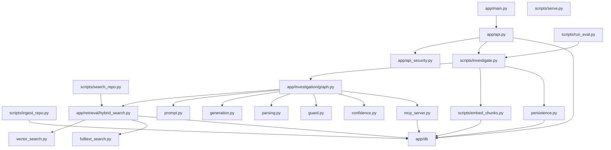
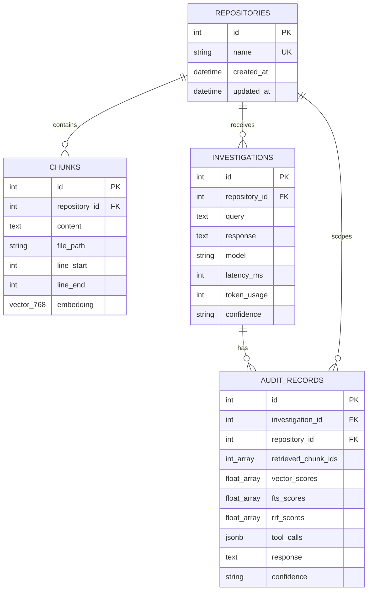
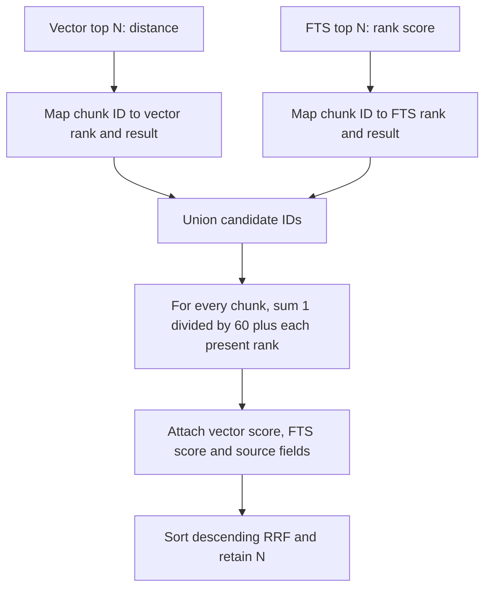
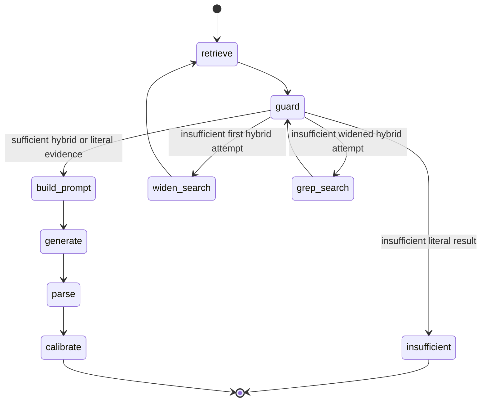
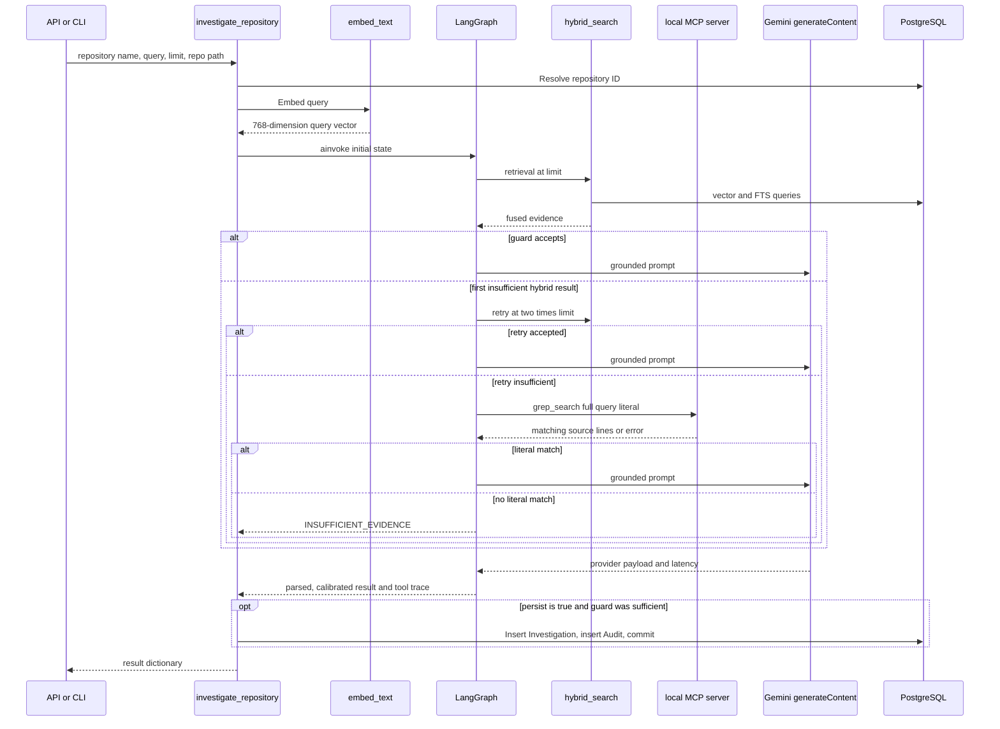
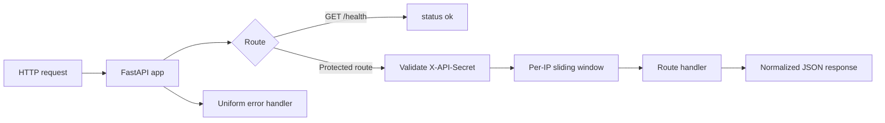

# IncidentWeave Low-Level Design

## 1. Scope and implementation status

This document records the low-level design implemented on the `main` branch. It is source-based: paths named here exist in the repository and diagrams model current runtime behavior. The Phase 1–9 build logs and [README roadmap](../../README.md#roadmap) are the in-repository plan baseline; the roadmap is complete at Phase 9. No standalone project-plan or chat-roles document was found in this checkout.

## 2. Package and entry-point map



| Entry point | Inputs | Output / responsibility |
|---|---|---|
| `app.main:app` | ASGI requests | Builds FastAPI, registers router and normalizes HTTP/validation/unexpected errors. |
| `scripts/serve.py` | None | Windows-safe Uvicorn launcher that selects `WindowsSelectorEventLoopPolicy` before loading the app. |
| `scripts/ingest_repo.py` | `<repo_path> <repo_name>` | Replace the named repository’s source chunks. |
| `scripts/embed_chunks.py` | `<repo_name>` | Embed only chunks with null vectors; print embedded/failed/skipped counts. |
| `scripts/search_repo.py` | repository name, query, optional limit | Embed query, run hybrid search and print ranked evidence. |
| `scripts/investigate.py` | repository name, query, optional limit/path | Run full investigation graph; persist generated sufficient-evidence results by default. |
| `scripts/run_eval.py` | evaluation CLI options | Validate/evaluate pinned corpus and write run artifacts. |
| `app.investigation.mcp_server` | stdio MCP transport | Exposes local `hybrid_search` and `grep_search` tools. |

## 3. Runtime configuration and database session

[`app/config.py`](../../app/config.py) defines `Settings` with `app_env`, `database_url`, `gemini_api_key`, and `api_protection_secret`. It loads `.env` using Pydantic Settings. Provider functions intentionally read `GEMINI_API_KEY` from the process environment.

[`app/db/session.py`](../../app/db/session.py) converts a plain PostgreSQL URL to `postgresql+psycopg://` when required, creates one async SQLAlchemy engine with `pool_pre_ping=True`, registers pgvector on each Psycopg connection, and exports `AsyncSessionLocal`. Callers open their own `async with AsyncSessionLocal()` blocks; there is also a `get_db_session()` generator.

## 4. Persistence design

### 4.1 Entity relationship model



The initial migration creates the `vector` extension and all four tables ([`20260819_0001_initial_schema.py`](../../migrations/versions/20260819_0001_initial_schema.py)). `Chunk` contains additional nullable metadata fields (`file_type`, `document_type`, `symbol`, `function_name`, `class_name`, `section`, `service`, `environment`, `incident_id`, `timestamp`) that the current Python ingester does not populate except `file_type` and `document_type`.

### 4.2 Referential behavior and indexes

- `chunks.repository_id`, `investigations.repository_id`, and both `audit_records` foreign keys use `ON DELETE CASCADE`.
- ORM relationships cascade orphan deletion from repository to chunks/investigations and from investigation to audit records.
- Declared indexes are `chunks(repository_id)`, `chunks(repository_id, file_path)`, and `investigations(repository_id)`.
- `retrieved_chunk_ids` is an integer array, not an element-level foreign-key relationship. Scores are stored as parallel arrays; `tool_calls` JSONB contains per-attempt detail and retrieval metadata.

## 5. Ingestion and embedding internals

### 5.1 Ingestion algorithm

```mermaid
sequenceDiagram
    participant CLI as ingest_repo.py
    participant FS as Local filesystem
    participant DB as PostgreSQL

    CLI->>FS: Resolve repo path and recursively find *.py
    FS-->>CLI: Sorted non-excluded files
    CLI->>DB: Find Repository by unique name
    alt repository absent
        CLI->>DB: Insert Repository and flush for ID
    end
    CLI->>DB: Delete existing chunks for repository ID
    loop each file and each non-redundant window
        CLI->>CLI: Join 60 lines; next start advances 50 lines
        CLI->>CLI: Create Chunk with relative path and 1-based range
    end
    CLI->>DB: add_all chunks and commit
```

`IGNORE_DIRS` excludes `.git`, `.kilo`, `.pytest_cache`, `.ruff_cache`, `.venv`, `__pycache__`, and `migrations`. `chunk_lines()` rejects overlap greater than or equal to chunk size and skips a final window that adds no new lines. The transaction deletes/replaces chunks by repository name; it does not record a filesystem root, Git commit, or ingestion manifest.

### 5.2 Embedding algorithm

`embed_repository_chunks()` selects all chunks for a named repository, filters to `embedding is None`, then calls `embed_text()` once per missing chunk. `embed_text()` POSTs Gemini `embedContent` with model `models/gemini-embedding-001` and `outputDimensionality` 768; it validates the returned list length before assignment. Errors are logged per chunk and do not abort remaining chunks. Each iteration waits 1.5 seconds, and successful assignments are committed after the loop ([`scripts/embed_chunks.py`](../../scripts/embed_chunks.py)).

## 6. Retrieval internals

### 6.1 Query contracts

| Function | Contract |
|---|---|
| `search_vector(session, repository_id, query_embedding, limit)` | Select embedded chunks for the repository; calculate pgvector cosine distance; return ascending top-N rows with `distance`. |
| `search_fulltext(session, repository_id, query_text, limit)` | Query `to_tsvector('english', content) @@ websearch_to_tsquery(query_text)`; rank by `ts_rank_cd`; return top-N rows with `score`. |
| `hybrid_search(session, repository_id, query_text, query_embedding, limit)` | Request N results from both functions, union chunk IDs, add RRF contributions, sort descending by `rrf_score`, and return N fused result dictionaries. |

### 6.2 Fusion algorithm



RRF preserves raw vector distance and FTS score beside a rank-only fused score. A chunk present in both source lists gets two contributions. The retrieval layer does not do reranking, token budgeting, deduplication of overlapping chunks, or separate index maintenance beyond ordinary database storage.

## 7. Investigation workflow internals

### 7.1 State and routing

`InvestigationState` holds repository identity/path, query/query embedding, initial and retry limits, retry flags, retrieved evidence, sufficiency result, parsed response, confidence/calibration fields, evidence source, tool trace, and optional prompt/provider payload. The graph is compiled by `create_investigation_graph()`.



### 7.2 Detailed execution sequence



### 7.3 Guard, prompt, parsing and calibration

- **Guard:** for hybrid results, `evaluate_evidence_sufficiency()` requires a maximum RRF score of at least `0.016` and a minimum available vector distance of at most `0.5`. For literal evidence, any non-empty match set is sufficient ([`guard.py`](../../app/investigation/guard.py)).
- **Prompt:** `build_grounded_prompt()` emits the system instruction, user query, and every retrieved result’s chunk ID, path, line range, scores and content. It asks the model to use only supplied evidence and to return `INSUFFICIENT_EVIDENCE` if unsupported ([`prompt.py`](../../app/investigation/prompt.py)).
- **Generation:** `generate_investigation()` calls Gemini with a 60-second request timeout and at most three attempts. HTTP 429/5xx and connection/timeout errors retry with 1- then 2-second backoff ([`generation.py`](../../app/investigation/generation.py)).
- **Parsing:** only the first Gemini candidate is parsed. Regexes extract a diagnosis, `high|medium|low` confidence, and cited retrieved chunks. A matching chunk ID, exact file path, or path/range pattern marks a citation ([`parsing.py`](../../app/investigation/parsing.py)).
- **Calibration:** only a `high` model confidence can be lowered to `medium`, when RRF is under `0.032` or vector distance exceeds `0.4` ([`confidence.py`](../../app/investigation/confidence.py)).

### 7.4 Persistence behavior

`persist_investigation()` reparses the provider payload, inserts an `Investigation`, flushes to obtain its ID, builds an `Audit`, then performs one commit. It saves query, parsed diagnosis, configured model, latency, token count and final confidence in both records. Audit additionally stores retrieved chunk IDs, numeric score arrays, cited chunk IDs, attempt trace and per-result metadata in `tool_calls` ([`persistence.py`](../../app/investigation/persistence.py)).

`investigate_repository()` returns early on guard insufficiency; therefore that branch has no `Investigation` or `Audit` insert even when its `persist` argument is true. A model-level abstention after a successful guard follows the generated persistence path.

## 8. API design



| Route | Protection | Behavior |
|---|---|---|
| `GET /health` | None | Returns `{"status": "ok"}`. |
| `POST /investigations` | Shared `X-API-Secret`, then rate limit | Validates `repository_name`, non-empty query, positive `limit`; runs/persists synchronously; returns diagnosis, confidence, citations, evidence check, tool trace, model and latency. |
| `GET /investigations/{id}` | Same | Reads one investigation and exactly one audit record; reconstructs returned evidence/tool fields. |
| `GET /repositories` | Same | Returns every repository’s total chunk count and non-null embedding count. |

`require_api_access()` uses `secrets.compare_digest` for the configured secret, then applies ten accepted requests per 60 seconds to the request client IP. HTTP validation/error handlers redact internal details into a consistent `{"error": {"code", "message"}}` shape. The API’s `raw_confidence` is reconstructed for the immediate POST response when calibration occurred; historical GET output is `null` because the raw label is not stored.

## 9. CLI and evaluation boundaries

| Interface | Boundary details |
|---|---|
| Ingest | Source write boundary: mutates chunks for the supplied repository name. |
| Embed | External provider plus database write boundary: mutates only null embeddings. |
| Search | External embedding call plus database read boundary; no persistence. |
| Investigate | External embedding/generation, database read, optional Investigation/Audit write, local filesystem grep fallback. |
| Evaluation | Exports the pinned source snapshot, validates golden labels and index reachability, sets up an allowlisted evaluation repository, runs retrieval/guard/pipeline metrics, and writes JSON reports. It invokes investigations with `persist=False`. |
| MCP | Local subprocess protocol boundary. `hybrid_search_tool` resolves a database repository and delegates to existing hybrid search; `grep_search_tool` resolves a repository then scans eligible Python files at the given path. |

## 10. Implemented limits and deferred behavior

- Only Python code is ingested. The broader `Chunk` model supports document/incident metadata, but current ingestion does not fill it.
- There is no background queue, cache, distributed rate limiter, multi-user authorization model, remote source connector, source revision model, or remote MCP service.
- API investigation is synchronous. The embedding and generation functions use blocking `urllib` calls within the workflow.
- `limit` is only constrained to be positive; the current API has no upper K/context-length budget.
- FTS and vector retrieval have no ANN/GIN index declared by the migration; this is the small-corpus V1 implementation, not a demonstrated large-scale design.
- The current roadmap ends at Phase 9. Existing deferred-optimization documentation is not an approved implementation plan for a Phase 10.

## 11. Source references

- [Application and API](../../app/main.py), [routes](../../app/api.py), [security](../../app/api_security.py)
- [Database infrastructure](../../app/db/session.py), [models](../../app/db/models/), [migration](../../migrations/versions/20260819_0001_initial_schema.py)
- [Ingestion](../../scripts/ingest_repo.py), [embedding](../../scripts/embed_chunks.py), [investigation](../../scripts/investigate.py)
- [Retrieval package](../../app/retrieval/), [investigation package](../../app/investigation/)
- [Evaluation package](../../evaluation/), [Phase 8 evaluation log](../phases/08-evaluation.md)
- [Phase documentation index](../README.md), [project README and roadmap](../../README.md)
